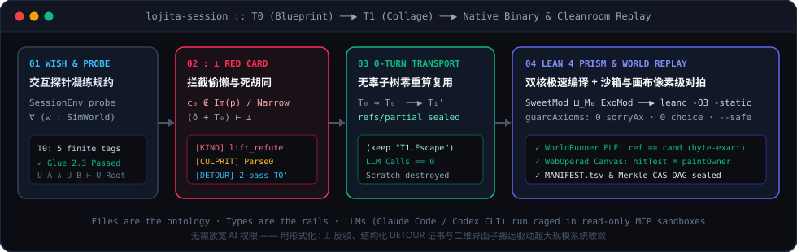

  

<h1 align="center">Lojita System</h1>

  <strong>Categorical Programming for the Post-Agent Era.</strong> 
  <em>Files are the ontology. Types are the rails. LLMs are just replaceable oracles.</em>

  <strong>以范畴式编程驱动的形式化许愿机</strong> —— <em>Vibe Coding 只适合玩具；范畴式编程才能托起巨型系统。</em>

  <a href="./README.md"><strong>简体中文</strong></a> ·
  <a href="./docs/README_EN.md">English</a> ·
  <a href="./docs/MANIFESTO.md"><strong>📖 完整理论与架构白皮书 (Manifesto)</strong></a>

  
  
  
  

<!-- 录屏完成后可将下方 ./docs/assets/hero-loop.svg 直接替换为 15~30 秒实录 ./docs/assets/demo.gif -->

  

---

## ⚡ 告别“拟人化 Agent”与“Vibe Coding”

市面上的主流 AI 编程产品把大模型拟人化成“坐在终端前聊天的数字实习生（Humanoid Agent）”——当项目膨胀到数万行时，上下文雪崩、偷改测试、分包走样接踵而至。

**Lojita System 不是另一个 Agent 编排框架，而是一台以类型化文件树为本体的操作系统。** 一会话对应一愿望；在这里，连系统调度自身的探测脚本与状态机都是经过机器检验的 Agda 代码，而大模型只是轨道上随用随换的局部推理算子。

| 维度 | Vibe Coding / 拟人化 Agent | Lojita System（范畴式编程） |
| :--- | :--- | :--- |
| **记忆与规模** | 单一长会话堆积全部探索与报错，工程越大越健忘 | **文件本体局部记忆**：平时零常驻进程；编译试错关在临时槽过关即焚，盘上只留纯净语义因果 |
| **权限与操作** | 对着未知目录盲敲 `bash` / `sed`，随时误删越权 | **线性所有权树（无 `write` 原语）**：`文件 = 资源 ⊗ !数据`，越权路径在类型层连名字都算不出来 |
| **模块分包** | 自然语言层层传话，3 层之后边界条件漏成筛子 | **Dialectica 先验条件粘合**：唤醒子包前必须先编译证明“子规约合取 $\implies$ 父规约”，分包只强不弱 |
| **排错与重构** | 测试挂了靠人工救火，AI 硬塞脏特判或推倒重写 | **`: ⊥` 红牌反驳 + 零重算复用**：死胡同交 `: ⊥` 精准打回，窄口弹 `DETOUR` 绕路，无辜子树 **0 次 AI 调用**直接复用 |

---

## 🧩 什么是「范畴式编程」？（30 秒直觉版）

不需要先啃完范畴论教材。在 Lojita 中，范畴式编程把人类驾驭超复杂系统的直觉凝练成了三个标准化动作：

<table>
  <tr>
    <td width="33%" valign="top">
      <h3>1. Wire · 按端口接线</h3>
      
<strong>不拼提示词，拼带颜色的接口。</strong>

      
每个模块都是带类型颜色端口的积木（有色复范畴）。把上游输出端口插进下游输入端口（<code>cut</code>），编译器在唤醒任何 AI 之前先锁死整张接线图的契约——写程序就是构造保接线的函子。

    </td>
    <td width="33%" valign="top">
      <h3>2. Lift · 从沙盘吹胀</h3>
      
<strong>先跑通 5 个点的骨架，再长出血肉。</strong>

      
面对几百条边缘需求，先忽略细节，在仅有几个枚举值的有限沙盘（<code>T0</code>）跑通分包逻辑；再通过 <code>El</code> 算子把底下的<strong>单个值</strong>一键吹胀成带完整状态与规则的上层局部子系统（<code>T1</code>）。

    </td>
    <td width="33%" valign="top">
      <h3>3. Refute &amp; Transport · 反驳与搬运</h3>
      
<strong>走不通就亮 <code>: ⊥</code> 红牌，绝不全部重来。</strong>

      
沙盘捷径在真实世界行不通？子节点直接构造闭合反例证明 <code>: ⊥</code> 打回重排底蓝图；架构重构是两端地位对等的异函子，未受波及的已完成模块 <strong>0 Token 消耗</strong>原样挂回新树。

    </td>
  </tr>
</table>

---

## 🔌 Bring Your Own Agent：驯化你手头的商用 Agent

**你不需要放弃正在付费订阅的 Claude Code 或 Codex CLI，更不需要冒着封号与违约风险去逆向“破壳”提取裸 API。**

大模型厂商习惯将最强推理模型与高性价比额度绑定在官方 CLI Agent 之中。Lojita 原生支持将它们直接接入为底层推理引擎，并在启动瞬间完成**“去壳入笼”**：

- **剥离危险宿主权限**：强制锁定只读空目录沙箱，关闭内置 Shell、任意文件写入与自治多智能体派发，彻底杜绝幻觉破坏工作区；
- **注入毫秒级只读预检（MCP）**：仅向其开放零副作用的 Lean 4 / Agda 形式化草稿自测工具（`check_agda`、`check_plan`）；
- **增信息、绝不增权限（0 假阳性）**：内核门禁寸步不让，绝不放过任何 `sorry`、隐藏公理或接口篡改；当 AI 撞上保守静态窄口（假阴性）时，系统自动弹出结构化 **`DETOUR` 绕路证书**（精确指出期望 vs 实际 AST 见证与等价改写处方），引导 AI 在草稿箱内改几行代码丝滑绕过。

---

## 🌌 同一台机器：从超大型软件直通经典数学定理

为什么业务软件工程显得**“庞杂但平庸”**，而著名数学定理显得**“简洁但深奥”**？

因为业务软件一开始就把跨系统架构（IO、文件树、终端协议、Canvas 视图）摊在了明面上；而初等数学命题只给出了单一离散整数世界里的最终验收规约，**隐藏了通往答案所需的跨世界有色复范畴结构**！一旦找对范畴结构，开发工业级软件与证明菲尔兹奖级经典数学定理，在 Lojita 中运行的是**完全同一套二维状态机**：

| 统一二维范畴状态机 | 超大型软件开发（例：Markdown 转换器） | 经典数学定理证明（例：Roth 三项等差数列定理） |
| :--- | :--- | :--- |
| **根世界强规约 $E$** | 端到端完整文档转换、安全属性与全系统世界耦合定律 | 离散整数算术 $(\mathbb{Z}, +)$ 上正密度子集必含三项等差数列 $x, x+d, x+2d$ |
| **底范畴弱沙盘 $T_0$** | 忘却具体字符串正文，投影为有限块标签枚举跑通分包骨架 | 退化到特征 $3$ 有限域 $\mathbb{F}_3^n$（Meshulam 沙盘，子空间零边缘泄漏，小维数毫秒穷举） |
| **单点吹胀为范畴（`El`）** | 标题单点标签吹胀为带 `1..6` 级深度与降级约束的小范畴；单步粗函数拆为解析与渲染串联 | 精确线性子空间单点 $H$（在 $\mathbb{Z}$ 中无有限子群对应）吹胀为带半径尺度参数的 **Bohr 集小范畴** |
| **`: ⊥` 反驳驱动重构与零轮次复用** | $T_0$ 单遍流式扫描丢弃尾注引用导致上层导出 `: ⊥` $\to$ 打回重构两遍扫描 $T_0'$，**0 轮 AI 调用直接复用转义子包 `Escape₁`** | $T_0$ 偷用子空间全局平移不变性导致整数层导出 `: ⊥` $\to$ 打回重构“宽母盒 + 窄子盒”双尺度蓝图 $T_0'$，**0 轮直接复用 Parseval 傅里叶能量旁支** |

---

## ⚙️ Agda + Lean 4 双核引擎与全栈能力

- **Agda 承接开放前沿，Lean 4 承载工业算力**：全仓以 `.agda` 为唯一权威源码，用 Agda 表达余归纳会话编排与开放范畴结构；通过声明级**安全推出粘合（$\mathrm{SweetMod} \sqcup_{M_0} \mathrm{ExoMod}$）**与保求值色编译，将成熟纯函数及自身 23 个核心调度模块透明转译为 **Lean 4 C++ 内核校验与 `gcc -O3` 静态原生二进制**，严格拦截 `Classical.choice`、`propext`、`sorryAx` 等一切公理走私。
- **外部世界的纯粹数学提炼（脑手分离）**：
  - **交互式 Web Canvas（`WebOperad`）**：业务侧 **0 手写 JS**——用有色平面 Operad 建模双向布局、用精确有理仿射变换群取代浮点误差，机器证明**“画家算法可见像素归属 $\equiv$ 逆变换点击命中路由”**，彻底根绝热区错位与模态弹窗点击穿透；
  - **操作系统世界耦合（`Context.World`）**：终端逻辑时钟（`pty`）、文件系统（`fsbox`）、回环网络（`netbox`）与 Git 沙箱组成正交乘积世界 `SimWorld`（单步跨能力互不干扰 Frame Law 直接化简为 `refl`），全系统仅经**唯一 8 行受审计薄解释器 `WorldRunner`** 静态链接落地，并在洁净室容器中完成字节级真实回放。

---

## 🚀 Quick Start

> 完整的 Linux 环境要求、`./build.sh` 全栈编译、AI 后端配置（`Code/AI.agda`）、CLI 子命令与 v7 离线回归门禁请参阅：**[构建与使用指南 (docs/QUICKSTART.md)](./docs/QUICKSTART.md)**。  
> *一键体验脚本与交互式 `WebOperad` 离线画布演示正在持续整理完善中。*

---

## 📚 深度入坑：阅读完整白皮书与专题规范

如果你希望深入理解 Lojita System 背后的线性逻辑文件树、有色复范畴函子/异函子方程、Cruttwell–Shulman 虚装备免商集机制、多模态类型论（Monadic vs Comonadic）跨语言边界以及双核保守性证明，请直接进入完整架构宣言：

👉 **[阅读《Lojita System 架构宣言与理论白皮书》(docs/MANIFESTO.md)](./docs/MANIFESTO.md)**

**专题技术文档导览：**
- [范畴式编程与机器数学的统一理论纲要](./docs/THEORY_UNIFIED.md) · [类型化拼接范畴与保类型函子](./docs/TYPED_COLLAGE_FUNCTORS.md)
- [Ownership.agda：线性逻辑类型化 Shell（`文件 = 资源 ⊗ !数据`）](./docs/OWNERSHIP.md)
- [Lean 4 Prism 双核推出切片、求值着色与原生自举架构](./docs/LEAN4_PRISM_BACKEND.md)
- [二维多对多函子化提升、`: ⊥` 反驳门禁与无辜子树零轮次复用规范](./docs/V7_2D_LIFT_RECOVERY.md)
- [WebOperad 有色算子代数画布工作台](./docs/WEB_OPERAD.md) · [参数化外部工具对拍](./docs/EXT_TOOLS.md) · [终端逻辑时钟语义](./docs/TERMINAL.md) · [开放世界会话协议](./docs/SESSIONS.md)

---

## License

本项目采用 [Apache License 2.0](./LICENSE) 开源协议。
