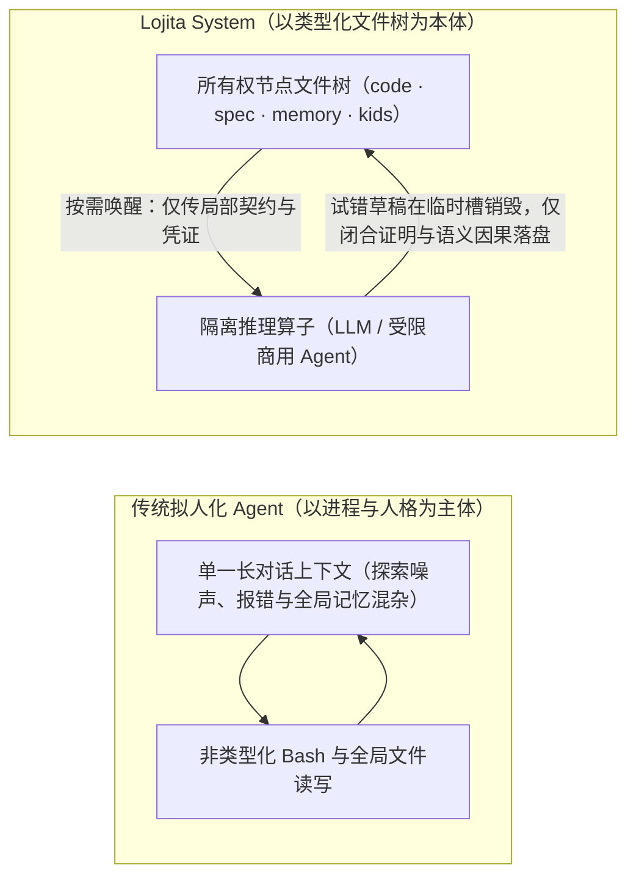
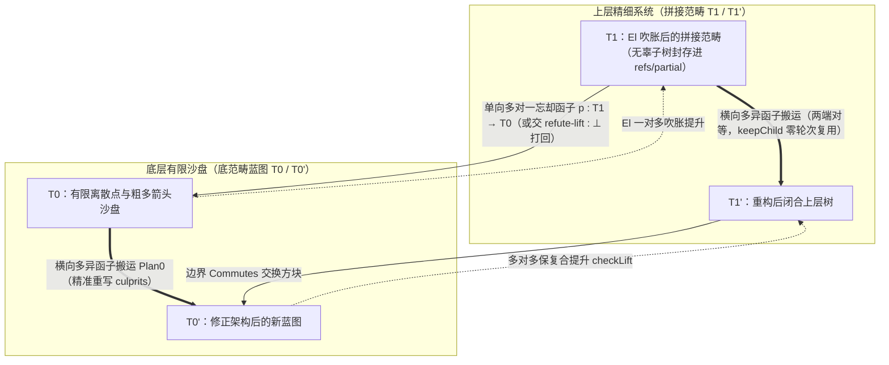
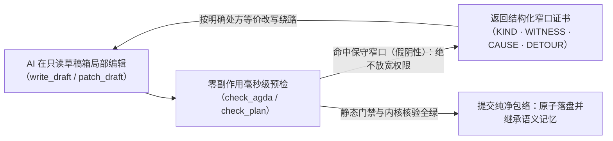

<p align="right"><a href="../README.md">← 返回项目主页 (README)</a> · <a href="./README_EN.md">English Overview</a></p>

# Lojita System 架构宣言与理论白皮书：以范畴式编程驱动的许愿机

> **把模糊的愿望凝练为严格的规约，在可验证的范畴轨道上生长出庞大的软件系统与深奥的数学证明。**

**Lojita System**（底层核心引擎代号 `CodeTransport`）是一台面向超大规模高可靠软件开发与前沿形式化数学探索的**“许愿机”**。它摒弃了当下主流 AI 产品将大模型拟人化为“人形智能体（Humanoid Agent）”的路线，转而构建了一套**以类型化文件树为本体、以范畴式编程（Categorical Programming）为唯一原语的形式化操作系统**。

在这套体系中，单个 AI 节点永远不需要充当上下文无限、全知全能的天才；复杂系统的宏大架构与数学证明的深邃创造力，由**线性资源所有权、Gödel Dialectica 双向博弈、虚装备（Virtual Equipment）上的纵向蓝图提升与横向异函子搬运**从拓扑结构中自然涌现。

---

## 目录

- [一、Lojita System 是什么：作为操作系统的“许愿机”，而非拟人化 Agent](#一lojita-system-是什么作为操作系统的许愿机而非拟人化-agent)
- [二、范畴式编程：辐射全栈的系统原语](#二范畴式编程辐射全栈的系统原语)
- [三、为什么会了范畴式编程，就几乎会了所有事：外部世界的数学提炼哲学](#三为什么会了范畴式编程就几乎会了所有事外部世界的数学提炼哲学)
- [四、工程理念：Agda 与 Lean 4 双核分工及“增信息、不增权限”的鲁棒性设计](#四工程理念agda-与-lean-4-双核分工及增信息不增权限的鲁棒性设计)
- [五、远眺：数学与编程的深层统一](#五远眺数学与编程的深层统一)
- [六、核心架构分层与文档导览](#六核心架构分层与文档导览)

---

## 一、Lojita System 是什么：作为操作系统的“许愿机”，而非拟人化 Agent

### 1.1 许愿机的闭环：交互澄清 $\to$ 行为规约 $\to$ 构造实现

向 Lojita System 许下一个愿望——无论是“构建一个支持流式筛选、符号链接分发、PTY 交互与网络超时的命令行工具”，还是“形式化复现一条经典组合数论定理的证明”——系统的工作方式都不是让 AI 直接盲写一坨代码碰运气，而是遵循严格的许愿闭环：

1. **交互与探测明确需求**：在开放世界会话根（Session Root）中，系统与用户对话或自主编写受控探针脚本（驱动终端、文件系统、回环网络、Git 沙箱或生成器收缩测试），消除自然语言的歧义与隐含边界，将模糊愿望凝练为**只针对可观测行为、不针对内部实现**的形式化规约（端口类型 + 全称结构定律 $\forall$ + 经实测锚定的边界样本）。
2. **封闭世界逐层兑现**：规约一旦确立，即移交封闭世界任务树，在零外部副作用的构造性类型论内核中层层分包、逐步提升、严格证明。
3. **现实世界对拍交付**：经唯一受审计薄解释器静态编译为原生程序后，强制在真实沙箱环境中对拍回放全部可观测行为，分毫不差方可结项。

### 1.2 范式分野：从“拟人化 Agent”走向“文件本体论操作系统”

今天市面上的绝大多数 AI 编程产品，都沿着 **思维链（CoT）$\to$ ReAct 循环 $\to$ 多角色拟人化团队** 的观念演进：它们试图把 AI 塑造成一个坐在 Bash 终端前的“数字程序员”，把**长期记忆、系统权限、持有资源与推理上下文**死死绑在同一个拟人化主体（Humanoid）身上。

这种拟人化隐喻在小玩具任务上很直观，一旦进入庞大复杂的工程便会遭遇结构性崩塌：
- **上下文雪崩与注意力稀释**：所有文件探索、编译报错、工具输出与历史包袱不断追加进同一条线性会话流（或依赖有损压缩摘要），工程越深入，有效信噪比越低；
- **未知世界上的盲目副作用**：传统 Agent 对着一个类型未知的操作系统文件系统敲打 `bash` / `sed` / 通配符，权限边界松散，极易产生隐式状态污染与规约漂移。

**Lojita System 更像一台操作系统：文件才是本体，AI 只是许愿机按需调用的智能来源之一。**



- **一会话一愿望（One Session, One Wish）**：我们让一个会话专职对应一个愿望/任务。用户的机器不为单一任务永久妥协，跨会话之间记忆与所有权严格隔离，仅通过内容寻址封存树或显式登记的接口契约交互。
- **记忆分散驻留于文件，上下文压力极小**：在两次唤醒之间，封闭世界节点**根本不存在常驻进程**——系统的全部延续性都落在文件树上。每个文件节点各自挂载属于自己的局部代码、局部接口规约与局部演进记忆（`Memory`）。唤醒某个节点时，它只需要面对自己这一小块窄上下文；而语法调试、类型报错等试错过程一律关在回合内的**临时草稿分支与“空文件”槽位**中，验证通过后临时分支即刻销毁，盘上只留存纯净的语义演进理由。因此，无论整棵工程树生长到多么庞大，单个节点的上下文始终轻盈如初。

### 1.3 对 Agent 过度工程的祛魅，以及对商用 Agent 的务实接入

按照文件本体论的视角拆解，一个节点完成工作真正需要的仅仅是三样东西：**挂在文件上的局部记忆 + 类型系统赋予的精确权限凭证 + 一次大模型推理**。市面上绝大多数层层封装角色设定、复杂记忆检索与花哨编排循环的 Agent 框架，本质上都属于**过度工程**。

但在现实商业生态中，头部大模型厂商普遍将自家最前沿的模型推理能力与高性价比订阅计划（Subscription Plans）深度绑定在官方 Agent 客户端（如 Codex CLI、Claude Code 等）之上。强行逆向“破壳”提取裸接口不仅技术上极易因协议变动而脆弱失效，更存在违反服务条款的法律与合规风险。

因此，Lojita System 采取了极其务实的兼容策略：**允许直接将商用 Agent 作为底层智能来源接入系统**，但在架构上对其实施彻底的“去壳驯化”——启动时强制剥夺其宿主机 Shell 执行、任意目录读写与自治多智能体派发权限（如锁定只读空沙箱、关闭内置终端工具），仅向其注入 Lojita 受控的只读形式化预检工具（MCP）与结构化包络协议。商用 Agent 得以合法、稳定地发挥其顶尖推理算力，而记忆管理、权限隔离与状态流转则 100% 收归 Lojita 内核掌控。

---

## 二、范畴式编程：辐射全栈的系统原语

在 Lojita System 中，“范畴式编程”不是外挂在传统代码上的事后静态检查器，而是**统摄整个系统的唯一原语**：从业务建模、跨阶段精化、存量代码重构、模块化分包，一直到文件权限管理乃至**系统调度自身的探测脚本、模糊测试收缩器与节点状态机**，全部由类型化的 Agda 代码直接写成。

### 2.1 范畴式编程的精髓：类型化拼接范畴、函子（程序）与异函子（搬运）

传统类型论编程习惯把“类型”看作孤立的离散集合（里面只有静态的值，没有非平凡的内在箭头），把函数看作单输入单输出的点对点映射。范畴式编程则将整套语言建立在**类型化拼接范畴（Typed Collage Category）与多色复范畴（Colored Polycategory）**之上：

#### 1. 点表示值，多箭头表示要保住的计算，接线即部分复合（Cut）
不引入任何虚假的内部张量积对象，每个颜色（基本类型）$A, B, \dots$ 直接标记拼接范畴 $\mathcal{C}$ 中的一个**块（局部范畴）**，块中的对象叫作该颜色的**点（值）**；多箭头的输入端与输出端直接是**有限有序颜色列表**（如 $(A, A)$、$(B, C)$），每个分量天然保有独立的端口序号。

连接各端口列表的**多箭头**（如 $f : (A, A) \to (B, C)$，$g : (B) \to (D, D)$）代表**系统必须保住的计算与不变量**。按端口位置选中 $f$ 的第 $1$ 个输出（色 $B$）与 $g$ 的第 $1$ 个输入（色 $B$）接成一根内部连线，并将 $g$ 的输出列表原地填入该槽位，就得到**沿单端口位置的部分复合（cut）**：

$$g \circ_{1, 1} f : (A, A) \longrightarrow (D, D, C)$$

未参与接线的 $C$ 直接从 $f$ 透传到外部。在满足不交叉（平面性或显式置换）条件下，部分复合严格满足单位律与结合律，同一张接线图上彼此独立的 cut 可以自由交换次序。

#### 2. `El` 提升与下降投影：把底层的“一个值”吹胀为上层的“一个范畴”
面对具有成百上千个边缘情况的复杂任务，Lojita 绝不让模型在一上来就陷入细节泥潭，而是先在仅有寥寥几个离散点（值）的**底范畴蓝图 $B$（$T_0$）**上跑通骨架，再通过提升算子 `El`（`Context/Blueprint.agda`）把细节逐层生长出来：

- **单点吹胀为局部范畴，多箭头升为多异函子**：给底层每个值（对象）$a$ 指定一个范畴 $\mathrm{El}(a)$ 作为其上层精细空间——$\mathrm{El}(a)$ 中的对象是位于 $a$ 上方的点，其内部态射位于底层恒等箭头上方。例如在迷你文档转换器中，底范畴 `BlockTag` 里的**单个枚举值** `KHeading`，经 `El` 一对多吹胀为“带 `1..6` 级深度对象及 `d < 5` 内部降级态射”的上层小范畴；对每支底层多箭头 $f$，则指定投影为 $f$ 的上层多箭头族 $\mathrm{El}(f)$。
- **自由部分提升（Partial Lifting）**：无需精化的端口直接保留在底层（`keepPort`）。例如对底多箭头 $f : (a_1, a_2) \to (a_3)$ 保留第 $1$ 端口 $a_1$ 为底参数、仅提升后两端口，即得混合多异函子 $H : (a_1, \mathrm{El}(a_2)) \nrightarrow (\mathrm{El}(a_3))$，集合值形式为 $H(a_1; -, -) : \mathrm{El}(a_2)^{\mathrm{op}} \times \mathrm{El}(a_3) \to \mathbf{Set}$（特别地，固定单一底点 $\star$ 并令 $E = \mathrm{El}(\star)$，内自多异函子 $\mathrm{El}(u) : (E^{\mathrm{op}})^m \times E^n \to \mathbf{Set}$ 即刻画了该点上方的全部 $(m, n)$ 元上层多箭头）。
- **目标代码零膨胀（拼接范畴本身就是普通范畴）**：将所有局部纤维沿多异函子粘合所得的**上层拼接范畴 $E$（$T_1$），本身就是一个最普通的范畴**！在目标 Agda 代码中，拼接对象直接写标准依赖和 `Σ Base El`，从上层到底层的忘却投影 $p : E \to B$ 直接就是普通单值函数 `fromEl : PortLift Base (Σ Base El)`——**往下看 $p : E \to B$ 是多对一的忘却压缩，反过来看 $B \leadsto E$（`El`）是一对多的吹胀展开**，目标层无需包裹任何笨重的高阶范畴类型。

#### 3. 函子对应“程序”，异函子对应“搬运”：同一套保结构原理的两面
在范畴式编程中，**“写程序（实现与跨层编译）”与“改代码（架构重构与搬运）”共享完全同一套有色复范畴与虚装备骨架，区别仅在于单向映射还是两端对等关系**：

- **保色复范畴函子 $F : \mathcal{C} \to \mathcal{D}$ 对应“程序 / 实现 / 编译”**：
  1. **颜色逐端口保块翻译**：颜色映射 $\rho$ 将整个 $S$ 块送入靶的 $\rho S$ 块，并在端口列表上逐分量作用 $(S_1, \dots, S_m) \mapsto (\rho S_1, \dots, \rho S_m)$，确保块内箭头 $f \in \mathrm{Hom}_B(b, b')$ 经翻译后确定落在同一目标块 $\mathrm{Hom}_{\rho B}(Fb, Fb')$ 中，绝不错位成跨块异态射 $\mathrm{Het}(X, Y)$；
  2. **源基本操作译为靶中的复合接线图（而非死板的单箭头对单箭头）**：源签名的单步基本操作 $H : (A, A) \to (D, D, C)$，在靶中不必对应单一函数，而是**直接将其译文指定为靶箭头族 $R$ 与 $S$ 沿内部端口（色 $\rho B$）接线的复合表达式** $F(H) = S \circ_{1, 1} R$（正如底蓝图的 1 个粗函数 `convert₀` 在上层实现为 `parse₁` 与 `render₁` 的多步串联）；
  3. **严格保持部分复合（单子态射式的代入原则）**：
     $$F(q \circ_{j, i} p) \;=\; F(q) \circ_{j, i} F(p)$$
     无需构造任何张量对象或手证结合律相干图——把源接线图中的每个基本操作直接代入其靶译文、沿原选定端口位置接回，整张接线图及定义等式严格成立。同时，由于下降投影 $p : E \to B$ 是**单向函子**（把程序看作证明，上层证明的命题严格强于下层：$E \implies B$ 但 $B \not\implies E$），下层沙盘编译通过的特解 $c_0$ 未必落在 $p$ 的像 $\mathrm{Im}(p)$ 内——一旦“提升不上去”，系统允许上层节点导出 `: ⊥` 反驳见证打回底范畴重构 $T_0 \leadsto T_0'$。

- **多色多异函子 $P : \mathcal{C} \nrightarrow \mathcal{D}$ 对应“搬运 / 重构”**：
  把单向函子 $F$ 换成**两头地位完全对等**的双边关系（Poly-profunctor，`Context/PolyTransport.agda`），其余全部原理——端口列表边界对齐、沿单端口的部分复合保持（`composeTransportsCut`）与边界交换胞腔核验——与函子**完全一致**！
  - 正因为源系统与靶系统**两头地位对等**，异函子天然统一了代码与概念演化的全部形态：**多对多重组、一对多拆分、多对一融合、零对多创生（`bot ⇝ unit` 引入新代码）与多对零消亡（`unit ⇝ bot` 废弃归入坟场）**，以及未变动子树的原样保留（`keepChild`）。系统严禁“整份覆盖后按同名函数倒推假映射表（`derivePlan`）”，所有合法 AST 存入 **Merkle 内容寻址存储（CAS）**；只要满足依赖前沿（`frontier`）完备性，挂在对象上的因果记忆预层 `Memory` 便沿异箭头精准继承。
  - **虚装备多格胞腔（免除余端商集与中间张量对象）**：正如复范畴不把端口列表压成张量对象，**Cruttwell–Shulman 虚装备（Virtual Equipment）**也不把一串横异箭头 $(R, S)$ 强行通过余端 $\int^{b \in B} R \times S$ 压成单个商对象，而是直接定义“顶部一串输入异箭头、底部单条输出异箭头”的多格二维胞腔：经柯里化后，前提侧的存在量词与商集 100% 转化为最外层的普通多参全称函数，在无商类型的 `--safe` Agda 中零 Setoid 负担，且父子接口切片（`restrict`）直接由笛卡尔限制泛性质 $Q(f,g)$ 一步给出。



### 2.2 Gödel Dialectica 范畴：保证层层分包绝不出错

多智能体软件工程最致命的顽疾是**分包失真**：顶层架构师把总需求拆成自然语言子任务发给下级，经过两三层传递后边界条件不断遗漏，子模块各自跑通了单元测试，拼回一起却无法闭合。

Lojita System 用 **Gödel Dialectica 范畴**彻底终结了这一顽疾。所有权树上的每个节点都是一个 Dialectica 对象 $\langle X, U \rangle_r$——其中 $X$ 是实现代码（规范化抽象语法 `Code`），$U$ 是父节点下达的行为规约（`Interface`），$r$ 是允许使用的推理系统包络（编译 `flags`，沿树单调收紧：传染性标志只减不增，`--safe` 等余传染标志只增不减）。

当父节点无法在单文件内完成实现、决定拆出子包洞 $A$ 与 $B$ 时，它构造的是一支严格的 Dialectica 多箭头（无需把两个拥有独立文件与记忆的子节点硬捏成单个张量对象）：

$$\left(\langle A, U_A \rangle_{r_A},\; \langle B, U_B \rangle_{r_B}\right) \;\longrightarrow\; \langle X_{\mathrm{root}}, U_{\mathrm{root}} \rangle_r$$

- **先验条件粘合门禁（`2.3` Glue Check）**：**在唤醒任何一个子节点之前**，父节点必须先写出子规约 $U_A, U_B$，仅凭子包的接口公理桩（`stubOf`）通过内核类型检查，给出条件证明：
  $$U_A \;\wedge\; U_B \;\wedge\; X_{\mathrm{root}} \;\vdash_r\; U_{\mathrm{root}}$$
  注意这里的箭头方向：程序替换从子指向父（$(A, B) \to \mathrm{root}$），逻辑蕴含**同样从子指向父**！这意味着**子节点的合取在数学上必然蕴含父节点**——无论向下分包多少层，最初的顶层设计只会不断加强，**绝对不可能被弱化或漏掉哪怕一个边界情况**。同时，系统静态提取父节点每条定理对子包引理的反向依赖映射 $g$：当局部设计调整未触及兄弟子包 $B$ 的依赖分量时，$B$ 继续安静运行或直接原样复用，免遭无谓重算。
- **双向反驳博弈（三条零启发式形式裁决通道）**：分包前我们只验证了“若子规约成立则父规约成立”，尚未验证子规约本身可被构造。如果父节点出了一道死题怎么办？子节点在类型上严禁留下 `postulate`、未填洞 `{!!}`、终止性绕过或针对测试字面量的脏特判；它唯有两条合法出路——**要么交出闭合实现，要么对父规约桩构造闭合反驳证明**：
  1. **`contradiction`（规约自相矛盾）**：仅引用当前规约桩导出闭合的 `: ⊥`，证明父节点下达的要求内在冲突，精准打回父节点重排架构；
  2. **`independent`（构造性独立禁忌）**：导出 `: SafeTaboo`，证明规约虽在经典外延模型中相容，却要求了 `--safe` 构造性内核不可证的原语/外延公理（如开放变量上的不透明原语自反性或函数外延性），引导父节点保留业务语义、换用可反射的判定运算重写规约；
  3. **`refute-lift`（跨层提升阻塞）**：联合当前上层规约桩与底层蓝图模块导出 `: ⊥`，证明底层沙盘特解偷用了简化假设而落在下降函子的像之外（$c_0 \notin \mathrm{Im}(p)$），自动静态提取底层闯祸单元打回重构底范畴，并抢救封存已验证完成的无辜兄弟子树供下一轮**零 AI 调用直接复用**。

### 2.3 文件所有权树：`文件 = 资源 ⊗ !数据`

在传统 Unix Shell 中，“文件”把**物理槽位控制权**与**内部承载的字节内容**混为一谈。Lojita 的底层内核（`Ownership.agda`）运用**线性逻辑（Linear Logic）**的指数模态 `!`（Of-Course Modality），将世界精确劈开为两侧：

$$\text{文件槽位} \;=\; \text{线性资源（}\mathrm{St}\text{）} \;\otimes\; !\text{笛卡尔数据（}\mathrm{Set}\text{）}$$

1. **笛卡尔数据侧（`!数据`，即纯粹的 `Set`）**：代码语法树 `Code`、接口规约 `Interface`、演进记忆 `Memory`、原始字节流 `Bytes` 都是数据。数据可以自由复制（`copy : A → A × A`）与丢弃，但**数据里绝对装不下任何资源权限**——因为资源在类型层是状态索引而非运行期值，从根源断绝了“把句柄塞进数据结构偷运越权”的可能。
2. **线性资源侧（`资源`，即所有权形状树 `St`）**：树上每个位置只有三种状态：
   - `File A`：持有类型 `A` 数据的叶子槽位；
   - `Dir Γ`：目录节点，**孩子的状态直接嵌在父亲的类型里——嵌套即所有权**。内核在类型上禁止对目录建立硬链接（`link` 仅限文件），静态保证了树状拓扑：**每个任务子包有且仅有一个父节点（“一包不能两用”）**；
   - `Chan S`：当父节点通过 `open′` / `openAs` 将一棵子树移交给外部服务或子节点运行时，原目录在原地变成一张不透明的线性会话收据 `Chan S`（遵循会话类型 `End`、`⊗`、`⊸` 与余归纳常驻服务 `SrvI`）。运行期间父节点在类型上根本无法窥探或篡改子目录内部（`peek` 直接触发类型错误），直至协议走完通过 `recover` / `stop` 原地收回子树。
3. **无 `write` 原语，脚本即已知形状树之间的态射**：
   系统没有原地覆写的 `write`；修改就是 `unlink` 旧文件 + `create` 新文件，整段脚本 `Prog Ψ s s′ A` 构成从形状 `s` 到形状 `s′` 的原子事务：
   - **告别未知文件系统的惊吓**：Bash 脚本对着未知目录盲猜，才需要 `ls` 与 `[ -f x ]`；`Prog` 的进出目录形状编译期已知，越界访问不是运行期报错，而是连位置索引都构造不出来（局部借用 `focus` 天然蕴含分离逻辑的 Frame Rule）；
   - **可证明的级联回收与零残留“空文件”**：析构器 `clear` 由 `rmdir` 只删空目录与会话必须走完的类型强制逼出“子先停、父后毁”的严格顺序；组合子 `withEphemeral` 允许在任意目录旁开辟临时槽位运行一次性探测或局部服务，因其进出类型同为 `Dir Γ`，编译期静态保证**用完即焚、磁盘零残留**。

---

## 三、为什么会了范畴式编程，就几乎会了所有事：外部世界的数学提炼哲学

初学者常有一个疑问：*纯函数式的依赖类型语言固然适合证数学题，但面对浏览器 Canvas 绘图、终端异步定时器、POSIX 文件系统与符号链接、网络套接字，乃至硬件电路、GPU 内核或底层系统语言，这套体系难道不会寸步难行吗？*

恰恰相反——**一旦真正掌握了范畴式编程，就几乎掌握了建模一切外部工具与异构语言的通用钥匙。**

现实世界的工程接口之所以显得琐碎肮脏，是因为工业界 API 往往直接暴露了底层的命令式可变状态与历史偶发妥协（如浮点数舍入误差、手动配对的 `save()/restore()` 状态栈、DOM 树与事件监听器的散乱耦合）。**对外部世界建模的关键，绝不是把宿主 API 一比一照抄成 FFI 绑定，而是提炼其背后的纯粹数学结构与全称代数性质，采用“脑手分离”架构：把 100% 的状态、几何与逻辑关进 `--safe` 封闭世界证明定律，把不可形式化检验的物理 IO 压扁成零业务逻辑的极薄字节中继。**

### 3.1 典范解剖：Canvas 与交互式 UI 的建模哲学

以 Lojita System 内置的 Web 可视化工作台（`Context/Tools/WebOperad.agda` 与 `UI/OperadApp.agda`）为例。传统前端开发饱受三大顽疾困扰：弹性布局算错导致子组件溢出重叠、命令式画布矩阵/裁剪栈错位、以及“眼睛看到的按钮位置”与“鼠标点击命中的热区”脱节（甚至穿透模态弹窗误触底层）。

范畴式编程通过四步数学提炼，在**业务侧零手写 JavaScript** 的前提下彻底根治了这些问题：

1. **提炼正确的范畴骨架 —— 有色平面 Operad（Colored Operad）**：
   UI 界面不是多输出的任意图，而是“将 $n$ 个子槽位组装进 1 个父容器槽位”的层次树 $(c_1, \dots, c_n) \to c$——它的精确数学真身正是**有色平面算子代数（Colored Planar Multicategory / Operad）**！每个槽位颜色 `SlotColor` 仅由一对不变量定义：`（最小几何尺寸 minSize , 业务消息类型 Msg）`。二元水平/垂直切分算子（`hsplitOp`、`vsplitOp`）、视口变换算子（`viewportOp`）与层叠算子（`zstackOp`）通过 Operad 同步复合 `compOp` 嫁接：向下自动解算每个子槽的矩形并附带**子框内含证明（`subRect-sound`）与兄弟绝不重叠证明（`disjointRect-sound`）**，向上汇总局部场景并精准路由强类型事件。
2. **用精确代数群取代浮点像素糊涂账**：
   内核严禁使用 `Float`。所有坐标与画布无级缩放平移全部建立在精确有理采样点 `QPoint` 与**可逆二维有理仿射变换群 `Affine2D`** 之上，在编译期机器证明正逆变换严格保持矩形归属（`inRectQ-inv-fwd` 与 `inRectQ-fwd-inv`），令缩放平移后的点击反演零舍入误差。
3. **用正反向对偶黄金定理锁死“所见即所点”**：
   声明式场景树 `Scene A` 显式区分可交互实体 `hitRect`、阻断穿透的不透明模态遮罩 `occludeRect` 与纯视觉装饰 `decorRect`，并在 `--safe` 下证明三条全称定律：
   - **栈平衡安全定理（`compileDraw-balanced`）**：编译生成的平坦画布指令流 `SAVE / RESTORE` 净深度恒为 `0`，在任意初始栈深下绝不下溢；
   - **视觉与交互命中严格一致定理（`visual-hit-consistent`）**：自顶向下带逆变换的短路点击路由 `hitTest`，在平面每一个有理点上与自底向上的画家算法可见归属 `paintOwner` **恒等（`≡`）**——眼睛看见谁在最上面，点击就必然命中谁；模态弹窗开启时，底层按钮被 `occludeRect` 遮蔽，点击穿透在数学上绝无可能发生；
   - **指令栈虚拟机等价定理（`draw-machine-sound`）**：命令式帧栈解释器的着色结果与声明式场景表面颜色逐点全等。
4. **双通道极薄宿主挂钩**：
   所有状态演进、视口手势、碰撞路由与防抖逻辑时钟全部运行在纯 Agda 中；外部仅挂载百余行零业务分支的浏览器 `<canvas>` 绘制薄壳（直接复用现成的 `agda --js` 后端离线打包），以及一个纯 C 编写的无依赖确定性像素光栅器 `web-relay.c`（注册为线性 `Ownership` 工具，将真实渲染出的像素帧缓冲与 Agda 纯预测颜色逐像素自动对拍）。

### 3.2 外部系统工具的统一建模

同一套“提炼数学结构 + 极薄物理中继 + 现实对拍验证”的范式，无缝覆盖了全部操作系统环境能力：

| 外部领域 | 提炼出的 `--safe` 核心数学结构与全称定律 | 极薄物理执行边界与一致性保障 |
| :--- | :--- | :--- |
| **交互式终端 (`pty`)** | 离散逻辑时钟状态机 `TimedMachine`（输入耗费 0 逻辑刻，仅 `sleepMs` 推进单调时钟，精确刻画超时前按键插队抢占）+ 流式 ANSI 屏幕增量投影同态 `stepANSI-++` | 静态 C 中继 `term-relay.c` 仅透传原始字节流、`TIOCSWINSZ` 尺寸信号与独立控制终端拓扑，与真实 `fzf` 等 TUI 对拍 |
| **文件系统、网络与 Git (`fsbox` / `netbox` / `gitbox`)** | 全称路径读写同调（Put-Get）与软链安全边界、HTTP 请求/响应报文编解码往返恒等、慢响应超时单调性与确定性提交树快照差异 | 无网只读容器与 `env -i` 洁净目录隔离，线性受管文件在 `stop` 时守恒归还 |
| **全系统世界耦合 (`World` & `Protocol`)** | 能力子集索引效应树 `WorldProg Δ A` + 正交分量乘积世界 `SimWorld`（`clock`/`env`/`tty`/`fs`/`net`/`git`/`web` 分立字段，**单步跨组件互不干扰 Frame Law 直接退化为定义等式 `refl`！**）+ 多服务对偶会话协议无死锁切消 | 彻底废除手写 `Main.agda` 胶水；全系统仅保留**唯一 8 行受审计薄解释器 `WorldRunner`** 静态链接 POSIX C 宿主，双环境模糊对拍字节级一致 |

### 3.3 对接其他语言与异构计算模型的两条路径

对于“如何在 Agda 之外对接其他编程语言或计算硬件”，首先必须剔除一种常见误区：**如果一门目标语言在结构约束上严格弱于 Agda（例如干净的函数式 JavaScript 本质上只是词法作用域的无类型 $\lambda$ 演算，变量可任意复制丢弃，完全被 Agda 的笛卡尔闭语境覆盖，且已有现成的 `agda --js` 后端），再去为它单独建模语法范畴纯属白费力气**——前端真正需要建模的是上文的 Canvas 等宿主工具，而非 JS 语言本身。

面对真正需要专门处理的其他语言或受限计算模型，我们根据**“Agda 自身的默认语境能否覆盖它”**，划分出两条层次分明的路径：

1. **路径一：在 Agda 内部设计 DSL，编写 IR-to-IR 转化器（适用于 Agda 能覆盖的情况，包含线性逻辑与 Rust！）**
   只要目标约束可以通过类型家族或参数化单子（Indexed Monad）封装在返回值与状态索引中，就直接在 Agda 内部定义嵌入式 DSL，再编写保结构的 **IR-to-IR 转化器**（如 $F : \mathrm{Code} \to \mathrm{Code}_{\mathrm{target}} + \bot$）。除了 `Context.World` 效应树与下文 Lean 4 Prism 的 `Code` $\to$ `Lean.IR` 同阶转译外，**线性逻辑与 Rust 所有权系统同样走的是路径一**！
   - *破除一个常见误区*：很多人直觉认为“线性逻辑限制复制与丢弃，难道不是 Comonadic 吗？”但站在笛卡尔宿主语言（Agda 的 `Set`）一侧看 Benton 线性/非线性伴随，可复制的数据留在宿主变量里自由传递，而线性资源则作为类型索引放进单子 `Prog Ψ s s′ A` 中严格单线流转——**`Ownership.agda` 恰恰就是用 Monad 完整表达线性逻辑的铁证**；同理，无 GC 的 Rust 所有权与借用也可直接写成 Agda 内建单子 DSL，再经 IR-to-IR 函子转译为干净的 Rust 中间码交由外部编译器核验。
2. **路径二：在 Agda 中显式建模目标语言范畴（适用于 Agda 默认语境覆盖不了的情况）**
   当任意宿主函数 $A \to M\,B$ 本身就不合法——最典型的是 **Conal Elliott 在 *Compiling to Categories* 中建模的硬件逻辑电路范畴、GPU 空间并行范畴或自动微分范畴**（你不能把一个不透明的任意 Agda 函数或捕获了外部宿主变量的闭包直接变成 FPGA 导线网表或求导算子）——单靠内建单子库已无法拦截非法的宿主语境捕获。此时必须在 Agda 内显式建模目标语言范畴：**以代码/端口类型为“点”，以目标系统允许的合法计算与组合算子为“箭头”**，用箭头组合取代宿主 $\lambda$ 抽象，再经编译函子导出目标代码。

> **与多模态类型论（MTT）的深层对应**：这两条路径的分界，精准对应多模态类型论中两类模态算子的实现复杂度——要表达 **Monadic（单子）模态算子**（哪怕内部承载的是 `Ownership.agda` / Rust 这样的线性状态变换），在宿主语言里**只写一个库（DSL）**就够了（路径一）；而要表达 **Comonadic（余单子）模态算子**（如 $\Box$ 模态，必须限制左侧输入语境 $\Gamma$ 本身的变量来源与封闭性），单靠宿主函数类型无从拦截，就必须**迭代编译器、多做一层类型检查**——在 Lojita 中，这多出来的一层类型检查，正对应于**在 Agda 内显式建模目标语言范畴**（路径二）。

---

## 四、工程理念：Agda 与 Lean 4 双核分工及“增信息、不增权限”的鲁棒性设计

### 4.1 Agda 承接开放数学前沿，Lean 4 承接成熟工业算力

在依赖类型系统的工程落地中，**开放前沿的表达力**与**极致底层的编译执行效率**往往难以兼得：
- **Agda** 拥有最自然的依赖模式匹配、余归纳进程与交互协议所需的受保护余递归（`--guardedness`）、高阶模块系统与 `--without-K` 等前沿类型论特性，是探索开放数学结构与表达线性会话编排的理想母语；
- **Lean 4** 拥有工业级的 C++ 校验内核、内存映射对象库、驻留式 Elaborator，以及基于求值严格性分析与 Perceus 精确引用计数的 LCNF 原生 C 代码生成器（`gcc -O3`），在大规模纯函数核验与二进制产出上具备数量级的速度优势。

Lojita System 的工程解法是：**全仓始终以 `.agda` 作为唯一权威真相源，将探索性与余归纳编排留在 Agda，将成熟稳定的计算与证明透明卸载给 Lean 4 Prism 后端**（甚至连 Lojita 自身 23 个核心 AST、范畴搬运与门禁模块都被直接转译编译为单个原生 Lean 4 二进制 `harness-engine`）。

连接双核的不是脆弱的字符串正则替换，而是预类型检查 `Code` IR 强连通分量（SCC）上的**有色多范畴安全推出粘合（Pushout Gluing）**：

$$M \;\cong\; \mathrm{SweetMod}(F_1, F_2) \;\sqcup_{M_0}\; \mathrm{ExoMod}(S)$$

- **去传染与内存直通核验**：切片器自动剥离文件级 `--guardedness` 的跨声明传染。绝大多数代数数据类型、高阶纯函数与等式证明（$F_1, F_2$，原生支持任意大自然数与字符串字面量的 $O(1)$ 模式匹配）直接在内存中降级为 Lean 4 `TSyntax` 极速核验，并经保持端口求值颜色（`ghost` 证明擦除 / `thunked` 按需惰性 / `strictVal` 严格传值）的执行函子直出高效原生 C 代码；
- **极小残差回退与零公理守卫**：唯有真正动用余归纳 copattern、复杂多参互递归或 `--without-K` 的极少数声明（$S$）才交由 `--safe` Agda 核验，两侧沿共享基底 $M_0$ 经相继式切消去（Cut）严密拼合；同时 Lean 4 侧内置编译期与内核级双重公理守卫（`guardAxiomsAssuming` / `Conservativity`），100% 阻断 `Classical.choice`、`propext`、`Quot.sound`、`sorryAx` 或 `partial` 递归偷渡，确保双核对拍逐字节一致。

### 4.2 允许假阴性，绝不允许假阳性：通过“增加信息而非增加权限”让 AI 绕路

在 AI 驱动的自动化工程中，门禁设计面临一个核心权衡：

> **假阳性（False Positive，把错的程序或假证明放行通过）是毁灭性的**——哪怕漏过万分之一的不健全公理或接口篡改，错误也会顺着分包树级联放大，彻底污染长期记忆；  
> **假阴性（False Negative，保守的静态门禁拒绝了某种语义上本可成立的花哨写法）则是完全可接受的——前提是系统能让 AI 轻松绕过去！**

许多系统一旦发现 AI 频繁卡在严格检查器上，就会本能地选择**“增加权限 / 放宽门禁”**（例如允许 AI 调宿主 Shell 自己改脚本、放开 `unsafe` 后门、或者把精确语法比对降级为宽松启发式匹配），结果瞬间击穿安全底座。

Lojita System 贯彻了截然相反的鲁棒性原则：**权限边界寸土不让（零假阳性），但通过向 AI 提供高密度的只读诊断信息（不增加任何写权限或公理权限）引导其丝滑绕路（Detour）**：



- **零权限扩张的只读预检沙箱**：节点在完全禁绝宿主 Shell 与外部文件写入的隔离环境中，拥有毫秒级的只读 MCP 预检工具（`check_agda`、`check_plan`、`check_spec`、`check_entry`）。AI 在正式提交前可以零成本反复预演搬运计划，预览未结清的 `frontier` 义务与快慢切片路由，而不会触发任何真实状态变更或唤醒子节点。
- **结构化窄口证书（`NarrowingCertificate`）**：每当代码触碰保守静态窄口——例如 `satisfies` 按精确 AST 比对签名时发现 AI 把隐式 `_` 写成了显式类型标注、触发了慢路径奇异语法、试图把外部不可证原语定律下推给空子包（公理洗钱拦截）、或超过推荐树深——门禁绝不只冷冰冰地报错，而是即时生成包含 **`[KIND]`（窄口类别）、`[WITNESS]`（期望 vs 实际的精确 AST 见证）、`[CAUSE]`（触发根因）与 `[DETOUR]`（构造性绕路建议）** 的四元组证书。
- **同义表达冗余换取工程鲁棒性**：编程语言与数学形式化天然具有极强的表达冗余度——同一条合法逻辑总有十几种等价写法，其中必然存在落在静态快车道甜区内的基础写法。拿到精确见证与绕路路标后，AI 只需用 `patch_draft` 修改寥寥数行即可绕开假阴性窄口，在**绝对零妥协的数学健全性**之上实现了极高的工程一次收敛率。

---

## 五、远眺：数学与编程的深层统一

### 5.1 为什么软件看似“庞杂但平庸”，数学定理却看似“简洁但深奥”？

Curry–Howard 同构早已指出，在**单个固定的类型系统内部**，“程序即证明，类型即命题”。但它没有回答一个困扰软件工程师与数学家的宏观反差：
- 真实的**业务软件开发**往往表现为**“需求极其庞杂琐碎，但每个局部逻辑直白平庸”**；
- 经典的**纯数学定理**（例如加性组合与数论中的 **Roth 三项等差数列定理**：“任意占正密度比例的整数子集，必包含三个数构成非平凡等差数列 $x,\, x+d,\, x+2d$”）却往往表现为**“命题陈述极其简洁初等，证明过程却深奥莫测”**。

从范畴化多模态逻辑（Kripke 世界语义：**一个范畴 = 一个拥有特定对象、运算律与推理代价的独立系统/世界**）的视角审视，这一表象对立瞬间冰释：

1. **业务软件把范畴结构摆在了明面上**：软件工程从第一天起就显式承认了多系统协同——开放世界 `IO`、线性所有权树 `St`、终端协议 `Terminal`、前端视图 `WebOperad`、各司其职的业务子模块与跨模块接口契约全部摊在台面上。正因为**跨系统的范畴与函子结构是显式的**，一旦切分清楚边界，每个局部节点内部的编码自然退化为平庸可控的常规劳动。
2. **数学定理的“深奥”恰恰是语言不恰当的体现——只给了扁平规约，隐藏了范畴结构**：一句初等数论或离散组合命题之所以极度简洁，是因为它**只站在刚性极强的单一根世界（如离散整数算术系统 $\mathcal{C}_{\mathrm{Arith}}$）内部陈述了最终验收规约**！如果强行困在只有整数加减法的单一语言里硬证，就像不设计词法、语法、IR 等中间范畴而直接用十六进制机器码手搓大型编译器一样，复杂度必然指数爆炸。人类赞叹的所谓“证明很深奥”，本质上并不是在单一系统里做了神鬼莫测的推理跳跃，而是证明者不得不暗中搭建出一整套**跨越多重数学世界的范畴网络**——例如在 Roth 定理的现代证明中，借道相位旋转与正交分解平庸至极的**圆环傅里叶调和分析世界 $\mathcal{C}_{\mathrm{Fourier}}$**、借道局部密度与 $L^2$ 能量递增平庸至极的**概率统计世界 $\mathcal{C}_{\mathrm{Prob}}$**，以及借道满足 $x+x+x=0$ 从而彻底消除边缘泄漏的**特征 $3$ 有限域沙盘世界 $\mathcal{C}_{\mathbb{F}_3}$**（Meshulam 有限域模型）。

**在每一个选对了语言的专属局部世界内部，数学推理与写业务代码一样，都是平庸而清晰的工程。**

### 5.2 统一方法论：寻找恰当的有色复范畴（Colored Polycategory）与函子

一旦看穿“深奥性 = 缺失恰当的范畴结构”，复现与探索深奥数学证明便与开发超大型软件系统汇入了完全相同的轨道——**寻找并演化恰当的有色复范畴 / 多范畴（Colored Polycategory / Multicategory）结构及连接它们的函子与多异函子**：

- **为什么是有色复范畴 / 多范畴（而非强行内化出单对象张量积或余张量积）？**
  - **多色（Colored）** 精准刻画不同的数学系统/计算机子系统或带约束的接口端口，静态阻止跨系统“公理走私”（例如防止特征 $3$ 有限域沙盘里的无进位对称性质泄漏回整数根世界）；
  - **多箭头（Poly-arrows / Multi-arrows，$(x_1, \dots, x_m) \to (y_1, \dots, y_n)$）** 直接使用有序端口列表，保留了多个独立前提模块、多路输出端口与各自记忆的真实个体边界，天然支持根岑相继式的**按位置单端口部分复合（切消去 Cut-Elimination，`cut₁`）**，并使跨范畴函子免于构造内部张量/余张量对象（幺半范畴或线性分配范畴）及手证庞杂的五边形与线性分配律相干交换图；
  - **不可表多异函子粘合（Collage）** 更突破了标准伴随模态逻辑要求两世界间存在单对象最优翻译（$L \dashv R$）的苛刻限制，使 Bourgain 将“有限域精确线性子空间单点 $H+H=H$”吹胀为“整数上带频率集与半径尺度参数的 **Bohr 集小范畴 $\mathcal{B}(S, \rho)$**（以半径收缩吸收加法边缘泄漏）”与软件开发中将“玩具枚举标签吹胀为有界深度文档语法树”共享完全同一套 `El` 提升机制！

| 统一二维范畴机器维度 | 超大型软件开发投影（例：Markdown 转换器） | 经典数学定理证明投影（例：Roth 三项等差数列定理） |
| :--- | :--- | :--- |
| **根世界强规约 $E$** | 端到端完整文档转换行为、安全属性与世界耦合全称定律 | 离散整数算术世界 $(\mathbb{Z}, +)$ 上正密度集必含 $x, x+d, x+2d$ |
| **底范畴弱沙盘 $T_0$** | 忘却具体字符串正文，投影为有限块标签枚举跑通分包骨架 | 退化到特征 $3$ 有限域向量空间 $\mathbb{F}_3^n$（Meshulam 沙盘，子空间零边缘泄漏，小维数毫秒穷举） |
| **单点吹胀为范畴（`El`）** | 标题单点标签吹胀为带标题级别 `Fin 6` 与降级约束的小范畴；粗函数一拆多为解析与渲染多步复合 | 精确子空间单点 $H$（在 $\mathbb{Z}$ 中无有限子群对应）吹胀为带半径尺度参数的 Bohr 集小范畴 $\mathcal{B}(S, \rho)$ |
| **`refute-lift` 反驳驱动概念重构** | $T_0$ 单遍流式扫描丢弃尾注引用导致上层导出 `: ⊥` $\to$ 打回重构为两遍扫描 $T_0'$，**零轮次直接复用已验完的转义子包 `Escape₁`** | $T_0$ 若偷用子空间全局平移不变性 $H+h=H$，整数层因边缘泄漏导出 `: ⊥` $\to$ 打回重构为“宽母盒 + 窄探针子盒”双尺度正则局部化引理 $T_0'$，**零轮次直接复用已验完的 Parseval 傅里叶能量旁支引理** |

在这台机器中，人类历史上高度仰仗灵光一现的“宏大软件架构设计”与“深奥数学概念发明”，被共同转化为可计算、可验证、可局部止损复用的范畴演化流水线：**退化沙盘探路 $\to$ 受阻单点吹胀为局部范畴 $\to$ 虚装备多格胞腔分配全局预算 $\to$ 构造性 `: ⊥` 反驳驱动双向异函子重构**。

---

## 六、核心架构分层与文档导览

Lojita System 的仓库实现严格遵循高内聚、零循环依赖的窄腰分层设计：

```text
Layer 0: 线性资源与会话协议内核（零外部依赖、零公理）
  └── Ownership.agda              -- 文件 = 资源(St) ⊗ !数据(Set)，Prog/Proc/ServerI，clear，withEphemeral

Layer 1: 封闭世界共享形式化语境库（100% --safe，供目标程序与证明树直接引用）
  ├── Context/Blueprint.agda      -- 纵向蓝图部分提升 PortLift、Tarski 纤维 fromEl、Commutes 交换图
  ├── Context/PolyTransport.agda  -- 横向多色多范畴端口关系 PortRel、部分复合 cut₁、TransportsPoly
  ├── Context/World.agda          -- 能力子集索引效应树 WorldProg Δ A、正交模拟世界 SimWorld
  ├── Context/Protocol.agda       -- 对偶会话协议、对合律与封闭世界多服务无死锁切消粘合
  ├── Context/Taboo.agda          -- 构造性独立禁忌见证 SafeTaboo
  └── Context/Tools/* & *Laws     -- 终端、文件、网络、时钟、Git、WebOperad 纯模型及全称代数定律库

Layer 2: 代码范畴、静态门禁与跨核转译底座（纯函数，核心模块同步自举编译为 Lean 4 harness-engine）
  ├── Code.agda & Code/*          -- 规范化 AST、Dialectica 粘合、多对多 Lift 与 PolyTransport、窄口证书
  ├── Store/* & Meta/*            -- Merkle 内容寻址存储（CAS）与元层/对象层命名空间及只读沙箱防火墙
  └── runtime/lean-prism/*        -- Lean 4 Prism 安全推出切片器、求值着色执行函子、公理守卫与只读 MCP 服务

Layer 3 & 4: 可信薄 IO 边界、商用 Agent 驯化适配与开放世界会话驱动
  ├── OwnershipIO/WorldRunner.agda-- 目标程序唯一合法的 8 行受审计薄宿主解释器（配合静态 C 中继群）
  ├── Code/AI.agda                -- 持久化语义线程与临时试错草稿分支隔离、受限商用 Agent / LLM 适配器
  └── Code/SessionRunner.agda     -- 开放世界探针运行、多阶段范畴树演化、静态编译与强制真实回放门禁
```
