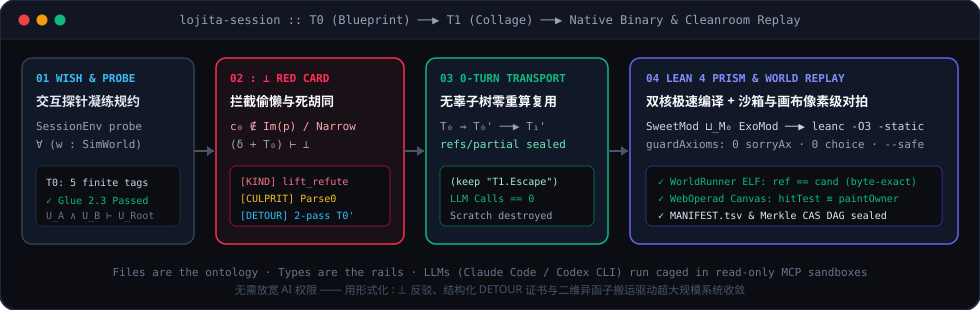

  

<h1 align="center">Lojita System &nbsp;<code>*⋉</code></h1>

  <strong>Categorical Programming for the Post-Agent Era.</strong> 
  <em>Files are the ontology. Types are the rails. LLMs are just replaceable oracles.</em>

  <em>Vibe Coding scales to toys. Categorical Programming scales to systems.</em>

  <a href="../README.md">简体中文</a> ·
  <a href="./README_EN.md"><strong>English</strong></a> ·
  <a href="./MANIFESTO.md"><strong>📖 Full Architecture Manifesto (CN)</strong></a>

  
  
  
  

  

---

## ⚡ Beyond Humanoid Agents & Vibe Coding

Most AI coding tools anthropomorphize LLMs into chatty interns sitting at a Bash prompt (*CoT → ReAct → Multi-Agent*). Once a codebase grows past a few thousand lines, context windows rot, specifications drift, and agents silently weaken tests to make builds green.

**Lojita System is not another agent wrapper—it is a file-ontological formal operating system.** One session corresponds to one wish. Even Lojita's own probing scripts and scheduling state machines are machine-checked Agda programs, while LLMs serve purely as stateless, replaceable local oracles.

| Dimension | Vibe Coding / Humanoid Agents | Lojita System (Categorical Programming) |
| :--- | :--- | :--- |
| **Memory & Scale** | One bloated chat log mixes exploration noise, compiler spam, and global state | **File-Attached Local Memory**: Zero resident agent processes between wakeups; draft retries vanish in ephemeral slots, persisting only verified semantic causality |
| **Authority & Safety** | Blind `bash` / `sed` mutations over an untyped filesystem | **Linear Ownership Tree (No `write`)**: `File = Resource ⊗ !Data`; out-of-scope paths cannot even be constructed at the type level |
| **Decomposition** | Natural-language telephone game loses edge cases across sub-agents | **Prior Dialectica Gluing**: Before waking any child, the parent must machine-prove `ChildSpecs ∧ Parent ⊢ ParentSpec` |
| **Debugging & Evolution** | Manual firefighting, hardcoded literal hacks, or full rewrites | **Formal `: ⊥` Refutation & 0-Turn Reuse**: Impossible specs return closed `: ⊥` proofs; narrow gates emit `DETOUR` certificates; innocent subtrees reuse with **0 LLM calls** |

---

## 🧩 What Is Categorical Programming? — Preserving Structure Across Transformations

The soul of category theory fits in one sentence: **preserving structure across transformations**.

Software engineering is a chain of transformations—from specification to implementation, from toy prototype to full production system, from legacy architecture to refactored architecture, and from verified logic to native machine code. Traditional coding and Vibe Coding collapse at scale because **every transformation silently breaks compositional invariants**.

**Categorical Programming locks down explicit typed port wiring (`cut`) first, and forces every transformation across the software lifecycle to preserve that structure:**

<table>
  <tr>
    <td width="33%" valign="top">
      <h3>1. Implementation &amp; Compilation Cut-Preserving Functors</h3>
      
<strong>Transform specs into code &amp; native binaries without losing wiring invariants.</strong>

      
A high-level operation may expand into a complex multi-module wiring diagram, yet a <strong>functor</strong> guarantees port boundaries and partial composition (<code>cut</code>) remain strictly invariant—and child decomposition never weakens parent specs.

    </td>
    <td width="33%" valign="top">
      <h3>2. Vertical Refinement Blueprint-Preserving Lifts</h3>
      
<strong>Transform a 5-point sandbox into a full system without collapsing control flow.</strong>

      
Project messy requirements onto a finite blueprint (<code>T0</code>) to prove the skeleton, then apply <code>El</code> to blow up each single base value into a rich local category (<code>T1</code>). Every upper refinement must commute with <code>T0</code>—or return a formal <code>: ⊥</code> witness to revise the blueprint.

    </td>
    <td width="33%" valign="top">
      <h3>3. Horizontal Refactoring Symmetric Poly-Profunctors</h3>
      
<strong>Transform old architectures into new ones without breaking causality.</strong>

      
Refactoring is not text overwriting—it is a <strong>two-sided symmetric relation</strong> preserving dependency closure across splits, merges, births, and deletions. Design memory flows along the transformation, while untouched subtrees reuse in <strong>0 AI calls</strong>.

    </td>
  </tr>
</table>

---

## 🔌 Zero-Cost Seamless Plug-In: Both APIs & Existing Agents

Because memory lives on the file tree and permissions live in the type system, Lojita decouples intelligence into a clean, stateless local oracle. **Whether you plug in a raw LLM API (direct adapter roadmap in progress) or an off-the-shelf commercial Agent you already subscribe to, integration is seamless and zero-cost:**

- **Zero Extra Spend, Zero ToS Risk**: Frontier labs often bundle their best models and generous quotas inside subscription CLI agents. Use your existing agent subscription out of the box—no expensive duplicate pay-per-token bills and no fragile reverse engineering.
- **Automatic De-Shelling**: When wrapping an external agent, Lojita automatically strips its host shell, arbitrary file writes, and sub-agent spawning, embedding it cleanly inside a read-only formal pre-check sandbox (MCP: `check_agda`, `check_plan`).
- **More Information, Never More Permission (0 False Positives)**: Soundness gates never compromise; when an AI hits a conservative syntactic gate (false negative), Lojita emits a structured **`DETOUR` certificate** (`[KIND] · [WITNESS] · [CAUSE] · [DETOUR]`) so the model routes around it in lines.

---

## 🌌 One Machine: From Large-Scale Software to Classic Theorems

Software looks *"sprawling yet locally routine"* because its multi-system boundaries are explicit; famous mathematical theorems look *"deceptively concise yet unfathomably deep"* only because they state acceptance specs inside a single rigid root world (`ℤ`) while hiding the cross-world categorical architecture. In Lojita, both run on the **exact same structure-preserving 2D state machine**:

| 2D Categorical Machine | Large-Scale Software (e.g., Markdown Converter) | Classic Mathematics (e.g., Roth's Theorem on 3-APs) |
| :--- | :--- | :--- |
| **Root World Spec $E$** | End-to-end document conversion & world-coupled `∀ SimWorld` laws | Every positive-density subset of $(\mathbb{Z}, +)$ contains $x, x+d, x+2d$ |
| **Base Sandbox $T_0$** | Forget strings to a finite block-tag enum blueprint | Degenerate to finite field $\mathbb{F}_3^n$ (Meshulam sandbox: zero boundary leakage, ms counterexamples) |
| **Fiber Blow-Up (`El`)** | Heading tag blows up to `Fin 6` depth category; coarse step splits into parse + render | Exact subspace point $H$ blows up to multi-scale **Bohr set category** $\mathcal{B}(S, \rho)$ |
| **`: ⊥` Refutation & 0-Turn Reuse** | Single-pass $T_0$ drops reference links $\to$ `: ⊥` triggers 2-pass $T_0'$, **reusing `Escape₁` in 0 LLM turns** | Global shift $H+h=H$ fails on Bohr sets $\to$ `: ⊥` triggers regular narrow/wide pair $T_0'$, **reusing Parseval energy lemmas in 0 turns** |

---

## 🚀 Quick Start & Deep Dive

> See **[Build, Configuration & Usage Guide (QUICKSTART.md)](./QUICKSTART.md)** for full Linux toolchain setup, `./build.sh`, AI backend configuration (`Code/AI.agda`), and v7 offline regression suites.

- **Full Manifesto & Theoretical Whitepaper**: [docs/MANIFESTO.md](./MANIFESTO.md)
- **Unified Theory Outline**: [THEORY_UNIFIED.md](./THEORY_UNIFIED.md) · [TYPED_COLLAGE_FUNCTORS.md](./TYPED_COLLAGE_FUNCTORS.md)
- **2D Functorial Lift & `: ⊥` Recovery (v7)**: [V7_2D_LIFT_RECOVERY.md](./V7_2D_LIFT_RECOVERY.md)
- **Lean 4 Prism Dual-Kernel Backend**: [LEAN4_PRISM_BACKEND.md](./LEAN4_PRISM_BACKEND.md)
- **WebOperad Canvas Workbench (0-JS UI)**: [WEB_OPERAD.md](./WEB_OPERAD.md)
- **Linear Ownership Kernel**: [OWNERSHIP.md](./OWNERSHIP.md)
- **License**: [Apache License 2.0](../LICENSE)
