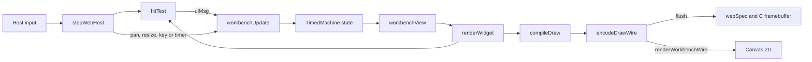

# The Agda ownership workbench

Open `ui/index.html` after running `python3 scripts/bundle_agda_js.py`. The page and its two scripts work offline. Click a stage or a node, drag the diagram, or use the wheel to zoom. **Details** opens a modal over the workbench. **Probe** starts a 500 ms logical timer. A second probe restarts the interval.

## From a click to a frame



`program = webProgram workbenchView workbenchUpdate` is the binding in Agda. For example, the Parser button carries `SelectNode Parser`. A click reaches the topmost visible node through the current scene. Its message updates `selectedNode`, and the next projection gives that node the selected colour in both the diagram and the sidebar. An occluding panel consumes the hit. The workbench model and its timers then retain their exact values. [Application](../UI/OperadApp.agda) · [Host transition and proofs](../Context/Tools/WebOperad.agda)

Inputs consume zero logical time. The host advances to timer deadlines and delegates each due tick to the existing terminal `TimedMachine`. The timer implementation preserves equal-deadline insertion order and applies cancellations and replacements. `AppInstance.wire-current` proves that its cached wire equals the current model's compiled view. Idle animation ticks advance the clock and reuse that wire.

## Layout and geometry

`LayoutOp inputs output` is a coloured planar multicategory operation with an ordered list of inputs and one output. A colour contains a minimum size and a message type. For a fitting parent rectangle, `placeSlots` supplies a rectangle, a size witness and a containment certificate for every child. `assemble` consumes the child scenes at those rectangles. `OpForest` tracks the input group at each graft. Flattening the groups fixes the resulting leaf order.

- `idOp` passes one slot through. `compOp` grafts an entire forest simultaneously. `plugOp here` and `plugOp (there i)` select a particular occurrence of a slot colour and fill the other positions with identities.
- `emptyOp`, `panelOp` and `buttonOp` are nullary. `mapMsgOp`, `padOp` and `viewportOp` are unary. The viewport zooms about its own origin, applies pan in device pixels, and clips at its allocated boundary.
- `hsplitOp` and `vsplitOp` allocate the leading child's minimum extent, a gap, and the remainder. `zstackOp` puts the first child in front. The binary operators return a sum of the children's message types. The workbench folds that sum into `WorkbenchMsg`.
- A `Widget` carries a closed operation. An undersized window renders the minimum layout through the actual window clip.

The sample `qpt x y k` represents `(x/(k+1), y/(k+1))`. Rectangles include their left and top edges and exclude their right and bottom edges. The affine matrix stores positive numerator and denominator and signed translation numerators. Its action on either axis is `(n*x + t)/d`. Both hosts use that convention. The C rasterizer computes integer sample ranges with exact ceilings and composes nested matrices in integer arithmetic.

| Machine-checked result | Guarantee |
| --- | --- |
| `inRectQ-inv-fwd`, `inRectQ-fwd-inv` | Both affine round trips preserve rectangle membership at every rational point. |
| `subRect-sound`, `disjointRect-sound` | Containment transfers membership. Disjoint siblings cannot share a sample, including when either rectangle has zero area. |
| `compOp-left-id`, `compOp-right-id` | Grafting identities preserves the assembled scene for arbitrary input scenes after the canonical list reindexing. |
| `hsplitOp-disjoint`, `vsplitOp-disjoint`, `tree-contained`, `root-outside` | Split siblings are disjoint, grafted leaves stay within the root, and the root rejects outside clicks. |
| `compileDraw-balanced`, `compileDraw-stackSafe` | The draw stream has net depth zero and returns to any initial natural depth without underflow. |
| `visual-hit-consistent` | Front-to-back hit routing equals ownership computed by the bottom-to-top painter. |
| `draw-machine-sound` | Running the flat solid-surface stream on an explicit frame stack gives `paintSurfaceColour` for every scene and point. |
| `click-miss`, `click-blocked`, `click-outside`, `idle-draw` | Missed, occluded and outside clicks preserve the complete host. An interval with no due timer preserves the view. |

`paintSurfaceColour` models interactive fills and occluding fills. Decorations preserve interaction ownership. The full visual stream additionally draws text, strokes, lines and decorative fills. The conformance tests sample full workbench frames away from decorative ink, exercise that ink separately, and compare every pixel of a nested solid-surface scene. [Pure regression script](../Test/Tools/WebOperadConformance.agda) · [Framebuffer conformance](../Test/Tools/WebToolIO.agda)

## Ownership channel

```agda
WebOwnedCtx cfg = map (λ n → n , File Bytes) (ownedFiles cfg)
webSpec = specI "webcanvas" WebConfig WebOwnedCtx
  (λ cfg → Srv WebStep RawWebObs (Dir (WebOwnedCtx cfg)))
```

`viewRegistry` contains both `ptySpec` and `webSpec`. The IO test uses `selectWeb` and `evalIO`. Its `openAs "canvas" "webcanvas" cfg` transfers a directory to the service. It calls `flush (renderWorkbenchWire app)`, reads pixel observations, and requests P6 export to a declared leaf. After `stop "canvas"`, ordinary `inside` and `read` recover the owned binary files. [Tool and registry](../Code/Tools/WebTool.agda) · [FFI](../OwnershipIO/Tools/WebFFI.agda)

| Relay request | Reply |
| --- | --- |
| `FLUSH hexWire` | Clear to transparent black, execute the frame, return `FRAME count depth`. A dash encodes an empty frame. |
| `PIXEL x y` | `PIXEL painted r g b` at the integer sample. |
| `RESIZE w h` | Reset dimensions, clip stack and framebuffer, then return `OK`. |
| `EXPORT_PPM relative/path` | Write binary P6 RGB to the owned leaf and return `OK`. |
| `STOP` | Return `OK`, exit and restore the owned files. |

The C host accepts canvases up to 2048 × 2048, 64 saved frames and a 4 MiB request line. Wire geometry uses signed 32-bit coordinates. It uses 128-bit intermediates and checks the reduced transform coefficients against a magnitude limit of 2⁴⁸. A malformed or out-of-range request fails the session. Text uses deterministic glyph cells in C and native text on Canvas. [Rasterizer](../runtime/tools/web-relay.c)

The Haskell boundary serializes calls and stop. It creates a private 0700 session root, stages byte files, and checks every path component. C opens exports relative to directory descriptors and checks the regular leaf before truncating it. Local runs use an empty environment. Docker runs with an unprivileged user, a read-only root, dropped capabilities and disabled networking. Cleanup handles failed startup, timeout, cancellation and repeated use of closed handles. [Transport](../runtime/tools/WebTransport.hs) · [Lifecycle tests](../Test/Tools/WebLifecycle.hs)

## Browser channel

The bundler invokes `agda --js`, follows the generated literal CommonJS imports, registers their factories and loads `window.AgdaOperadApp`. It checks the complete import closure and matches the six browser calls to generated exports. The runtime bridge supplies the two character conversion primitives missing from Agda 2.6.3's JS output and iterates strings by Unicode code point. The linked artifact is available at `ui/dist/agda-bundle.js` with its build copy under `tmp/js-build`. [Bundler](../scripts/bundle_agda_js.py)

| Browser hook | Inputs |
| --- | --- |
| `initWorkbench`, `resizeWorkbench` | Width and height in canvas pixels |
| `clickWorkbench` | Canvas x and y |
| `panWorkbench` | Direction and step. Codes 0–3 move left, right, up and down. Codes 4–5 forward wheel zoom. Code 6 forwards Escape. |
| `tickWorkbench` | Elapsed whole milliseconds |
| `renderWorkbenchWire` | Current opaque application instance |

The relay passes natural numbers as curried `BigInt` arguments. It tracks native pointer gestures, forwards keyboard, wheel, resize and animation events, and executes the wire's eight Canvas commands. All application actions, hit regions, camera state, modal routing and timer edits live in Agda. [Browser relay](../ui/web-relay.js) · [Offline entry point](../ui/index.html)

## Verification

```sh
./test-web-operad.sh
./test-evalio.sh
```

The web suite checks the safe modules, rejects ill-typed arity, colour and occlusion counterexamples, builds the static C relay, and exercises both Ownership sandboxes according to availability. It checks 51 workbench pixels across five frames and all 24 pixels of the nested surface scene. It also compares the complete small P6, the workbench P6 header, size and sampled pixel, and a separate binary input after linear restoration.

Local tests always run. A successful `docker info` enables the cleanroom tests with `programbench/junegunn_1776_fzf.b56d614:task_cleanroom_v6` and the original `test-term.sh`. Set `REQUIRE_DOCKER=1` to require the daemon. When Docker is unavailable the suite runs the terminal baseline's local fixtures and lifecycle tests directly. The bundle builds offline without Node. An available Node executable also runs the compiled interaction smoke test. [Test runner](../test-web-operad.sh)
