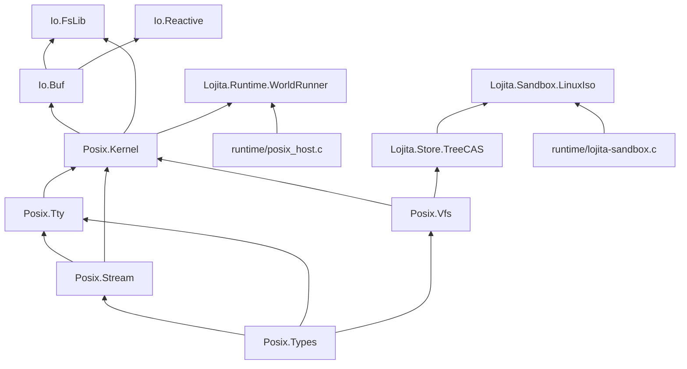

# Lojita vNext IO 层与类 Linux 内核底座：工程技术规范与验收标准

> [!IMPORTANT]
> **任务定位与交付目标**：本文档是新版 Lojita System **底层 IO 与沙箱内核底座重构**的完整技术契约与验收标准，供开发成员在**全新工作区与全新 Git 分支**独立实施。老版代码（[v9-pure-lean4](file:///root/Documents/Codex/handoffs/CodeTransport-730010e3/worktrees/v9-pure-lean4)）仅作反面教材与背景参考，**严禁在老版上修补或照搬其 `PosixChannel` / `VirtualFs` / `cli_host.c` 逻辑**。

---

## 零、架构哲学：关键少数“殖民据点”与“逃生舱”分层

### 0.1 宏观演进观：自上而下吞没未验证解释层
Lojita OS 的演进不是凭空造一个脱离现实的玩具系统，而是**保持宿主机（`ubuntu_24_04_x64`）原有外部行为不变，在庞杂 Linux 系统的关键咽喉位置建立零公理 Lean 4“殖民据点”，逐步扩大形式化代码与硬件指令集之间的版图，吞没中间未验证的 C 解释层**：
1. **当下（影子内核据点 + 物理防爆沙箱）**：底层物理执行暂借宿主 Ubuntu 24.04 内核，但在 Lean 4 中建立与之严格迹精化对齐（`Ubuntu 6.8 ⊑ PosixCore`）的纯内核状态机与 `TreeCAS` 命名空间沙箱；Lojita 此后合成的每一个验证程序，天生就是未来 Lojita OS 的原生用户态资产。
2. **中期（用户态微内核 / 类 gVisor Sentry）**：将 `PosixCore + TreeCAS` 编译为系统调用裁决守护进程，直接接管子进程文件与流语义。
3. **远期（原生 Lojita OS）**：底层替换为最小硬件启动层与 VirtIO 驱动，上层 `PosixCore` 定理体系、`TreeCAS` 存储与全部已验证用户态程序零修改合拢。

### 0.2 如何对待“非函数式/非范畴式”的 Linux 设计？（关键少数 + 逃生舱预留）
Linux 充斥着大量命令式可变设计与历史包袱，我们采取**三层分流策略**，既防“屎山建模”，又防“表达力锁死”：
1. **核心 20% 命令式共享特性 $\to$ 纯有限映射状态机化（本次必做）**：
   像 `dup2` 共享文件偏移量、`unlink` 打开中的文件仍可读写、非阻塞 `EAGAIN`、管道半关闭、`EINTR` 信号打断与短读写（Short Read/Write），看似“很命令式”，实则是 **95% 真实系统软件赖以生存的灵魂契约**。把三层表（`FD ⇀ OFD ⇀ Inode`）建模为纯有限映射上的状态转换 `(ProcState × KernelState) → Ret × (ProcState × KernelState)`，就能用 100% 纯函数式 Lean 4 精确表达这些命令式别名语义。
2. **用户态便利操作 $\to$ 上移为纯 `LojitaCtx` 标准库（本次必做）**：
   `BufReader`、`readLine`、`readAll`、`writeAll`、`mkdir -p`、原子写文件以及交互式 `ReactiveApp` 事件循环，全部移出内核原语层，写成跑在最小系统调用之上的纯 Lean 4 库函数，使模拟内核与真实 Linux **100% 共享同一份缓冲与控制流代码**。
3. **长尾 5% 怪异内核特性 $\to$ 预留“会话级逃生舱（Escape Hatch）”接口（本次仅留架构插槽，不实现会话工作流）**：
   对于特种 `ioctl`、`mmap` 共享内存、`/proc` 内省、SIMD/异构 C 库等低频或极难纯形式化的特性，**绝不塞进 `PosixCore` 污染核心模型**。我们在架构上做两手准备：
   - **类型与凭证层预留插槽**：在能力枚举中预留受隔离的扩展标签 `.foreignCap (tag : String)`，默认在普通封闭节点门禁（`CoreCaps`）中**静态禁用**；未来在会话节点（`SESSION_ROOT`，由人工管理外接工具）遇到必须动用特殊特性的程序时，允许显式开启“逃生舱模式”挂载非安全/非 Lean 4 的 IO 扩展垫片，并在最终交付收据（Receipt）的 TCB 清单中显式打上受控污点标记（绝不伪装成零公理纯证明）。
   - **物理层兜底隔离**：由于本次落地的宿主沙箱（`lojita-sandbox`：Linux Namespaces + `pivot_root` + 只读 `TreeCAS`）包在**整个操作系统进程最外层**，未来即使逃生舱在对象层运行任意不安全的 C/Rust/汇编代码，在物理上也 100% 被困在沙箱内，绝无可能污染宿主机或 Lojita 元层。

---

## 一、工程组织、模块切分与四条死红线

### 1.1 新分支目录结构与单向依赖图
在全新工作区与独立 Git 分支中，IO 与隔离底座严格切分为以下 **8 个小而精的模块**（严禁出现跨层反向 `import` 或巨石文件）：

```text
├── LojitaCtx/                      # 【纯形式化公开语境库：零 IO、零公理、零 extern】
│   ├── Posix/                      # 内核态核心殖民据点（PosixCore）
│   │   ├── Types.lean              # L0: 句柄、标志位、Errno、StatObs、StepSlice (≤ 150 行)
│   │   ├── Stream.lean             # L1a: 引用计数字节流、半开管道与 EPIPE/EAGAIN (≤ 180 行)
│   │   ├── Tty.lean                # L1b: 最小 Termios/Winsize/PtyPair 与纯屏幕投影 (≤ 220 行)
│   │   ├── Vfs.lean                # L1c: Inode 图、锚定路径拉链 Namei、严格 *at 语义 (≤ 300 行)
│   │   └── Kernel.lean             # L2: ProcState/KernelState 三层表、Cap、SysOp、ppoll (≤ 320 行)
│   └── Io/                         # 用户态纯标准库（100% 跨 Sim 与真实 Linux 共享）
│       ├── Buf.lean                # L3a: BufReader/BufWriter、readLine/readAll/writeAll 与汇合定理 (≤ 280 行)
│       ├── FsLib.lean              # L3b: readFileAll/writeFileAtomic/mkdirP 与精化桥定理 (≤ 200 行)
│       └── Reactive.lean           # L3c: 编译至 sysPpoll + 非阻塞 Fd 的纯 ReactiveApp 组合子 (≤ 180 行)
├── Lojita/                         # 【元层宿主与基础设施】
│   ├── Runtime/
│   │   └── WorldRunner.lean        # L4: 唯一薄系统调用 IO 解释器（仅服务 CoreCaps）(≤ 180 行)
│   ├── Store/
│   │   └── TreeCAS.lean            # L5a: BlobHash/TreeHash 内容寻址树与 Posix.Vfs 无损互转 (≤ 240 行)
│   └── Sandbox/
│       └── LinuxIso.lean           # L5b: Linux 命名空间沙箱驱动与 Ownership 线性资源闭环 (≤ 260 行)
├── runtime/                        # 【极薄零业务 C 原语层】
│   ├── posix_host.h / posix_host.c # 1-to-1 无状态系统调用与 errno 透传 (有效代码 ≤ 250 行！)
│   └── lojita-sandbox.c            # unshare + pivot_root + RO bind-mount + rlimit 启动器 (有效代码 ≤ 300 行！)
└── Test/                           # 【自动化门禁套件】
    ├── TheoremPin.lean             # 锁死 17 条核心定理精确类型签名的防篡改桩
    ├── PosixTwinGates.lean         # 正负双生语义回归与防放水门禁
    ├── FuzzConformance.lean        # FuzzGen 随机系统调用序列生成与收缩器
    ├── LiftIoShowcase.lean         # T0 (整读) → T1 (流式分块读) 跨层精化端到端样例
    └── scripts/                    # Ubuntu 24.04 实测对拍与红队越狱测试脚本
```



### 1.2 四条架构死红线（违反任一条直接打回）
1. **零公理与纯度铁律**：`LojitaCtx/**` 下严禁出现 `axiom`、`sorry`、`unsafe`、`partial`、`@[implemented_by]`、`@[extern]` 或 `IO`；所有递归函数必须通过结构递归或良基终止检查；核心载体统一住在 `Type`（`Type 0`），避免宇宙层级膨胀。
2. **反屎山体量红线**：
   - `runtime/posix_host.c` 去除空行与注释后的有效 C 代码行数 **必须 $\le 250$ 行**（严禁任何静态读写缓冲数组、严禁路径字符串改写或自动建父目录、严禁事件循环状态机）；
   - `runtime/lojita-sandbox.c` 有效 C 代码行数 **必须 $\le 300$ 行**；
   - `LojitaCtx/Posix/*` 与 `LojitaCtx/Io/*` 下任意单个 `.lean` 文件有效行数 **必须 $\le 350$ 行**。
3. **零评测题特判红线**：任何模块中严禁出现针对 `gron`、`fzf`、`pandoc` 等具体基准题的字符串、启发式分支或特权通道。
4. **宁可假阴性、绝不假阳性**：禁止为了“让对拍变绿”而在模型中吞掉错误码、放宽引用计数不变量或弱化 `Test/TheoremPin.lean` 中的定理签名。

---

## 二、各模块精确技术契约与 17 条必证黄金定理

### 2.1 `LojitaCtx.Posix.Types` —— 错误码、标志位与非确定性切片参数
1. **标准 `Errno`**：至少完整覆盖并精确映射 Linux `x86_64` ABI 错误码：`ENOENT(2)`, `EINTR(4)`, `EIO(5)`, `EBADF(9)`, `EAGAIN(11)`（与 `EWOULDBLOCK` 同码）, `EACCES(13)`, `EEXIST(17)`, `EXDEV(18)`, `ENOTDIR(20)`, `EISDIR(21)`, `EINVAL(22)`, `EMFILE(24)`, `ENOSPC(28)`, `ESPIPE(29)`, `EROFS(30)`, `EPIPE(32)`, `ENAMETOOLONG(36)`, `ENOTEMPTY(39)`, `ELOOP(40)`, `ECONNREFUSED(111)`, `ETIMEDOUT(110)`。
2. **环境非确定性切片 `StepSlice`（把不可验证的 Linux 调度纳入纯形式化的核心机关）**：
   ```lean
   structure StepSlice : Type where
     maxBytes    : Nat  := 65536 -- 本步最多传输字节数（建模内核短读/短写；>0 时按上限截断）
     intrBefore  : Bool := false -- 本步阻塞/传输前是否被信号打断返回 EINTR
   ```
   - `canonicalSlice : StepSlice := {}` 用于确定性快速求值；
   - 对拍器可将真实 Linux `read`/`write` 实测返回的字节数 $k$ 填入 `StepSlice.maxBytes`，检验真实内核每一步是否严格落在 `PosixCore` 规约包络内。

### 2.2 `LojitaCtx.Posix.Stream` —— 引用计数字节流与半开管道核
1. **状态定义**：`StreamBuf` 维护字节队列 `buf`、容量上限 `cap`（默认 `65536`）以及**由打开文件表派生的端点数** `readers : Nat` 与 `writers : Nat`（绝不用孤立的 `closed : Bool` 猜测半关闭状态）。
2. **读写转移规则**：
   - `streamRead (slice : StepSlice) (nonblock : Bool) (s : StreamBuf)`：
     - 若 `slice.intrBefore`：返回 `(.err .EINTR, s)`；
     - 若 `s.available > 0`：弹出 `k = min s.available (max 1 slice.maxBytes)` 个字节 ` chunk`，返回 `(.ok chunk, s')`；
     - 若 `s.available == 0 ∧ s.writers == 0`：返回 `(.ok [], s)`（**0 字节即标准物理 EOF**）；
     - 若 `s.available == 0 ∧ s.writers > 0`：`nonblock = true` 时返回 `(.err .EAGAIN, s)`；阻塞模式返回 `(.wouldBlock .waitReadable, s)`。
   - `streamWrite (slice : StepSlice) (nonblock : Bool) (bs : Bytes) (s : StreamBuf)`：
     - 若 `s.readers == 0`：对非空写入立即返回 `(.err .EPIPE, s)`（附带触发 `SIGPIPE` 标志）；
     - 若 `slice.intrBefore`：返回 `(.err .EINTR, s)`；
     - 若 `bs.isEmpty`：返回 `(.ok 0, s)`；
     - 若 `s.freeSpace == 0`：`nonblock = true` 返回 `(.err .EAGAIN, s)`，否则 `(.wouldBlock .waitWritable, s)`；
     - Linux x86-64 的匿名管道按 4096 字节页分配槽位。非空且长度不超过 `PIPE_BUF = 4096` 的写请求保持原子性；若本次写不能完整提交，非阻塞模式返回 `EAGAIN`，阻塞模式等待可写。大写入允许部分成功，按实际返回的字节数推进。模型需区分队尾可追加的空间和只能通过释放整页得到的空间。
3. **必证黄金定理**：
   - **T1 (`streamRead_eof_iff`)**：当 `¬slice.intrBefore` 时，`streamRead` 返回 `.ok []` 当且仅当 `s.available = 0 ∧ s.writers = 0`。
   - **T2 (`streamRead_blocked_preserves`)**：当 `streamRead` 返回 `.err .EAGAIN`、`.err .EINTR` 或 `.wouldBlock _` 时，输出状态 `s' = s`（**1 个字节都不允许丢失**）。
   - **T3 (`streamRead_byte_conservation`)**：当 `streamRead` 返回 `(.ok out, s')` 时，`out ++ s'.pendingBytes = s.pendingBytes`。
   - **T4 (`streamWrite_epipe`)**：当 `s.readers = 0 ∧ bs ≠ []` 时，`streamWrite` 必返回 `(.err .EPIPE, s)`。

### 2.3 `LojitaCtx.Posix.Tty` —— 最小行规程与纯屏幕投影解耦
1. **最小 `Termios`**：仅建模影响语义的核心布尔开关 `{ icanon : Bool, echo : Bool, isig : Bool, icrnl : Bool, opost : Bool }`，提供 `rawTermios`、`canonTermios` 与 `cfmakeraw`。
2. **`PtyState`**：封装主从双向流、`Winsize (rows, cols)` 与规范模式行编辑缓冲（`icanon = true` 时遇 `\n` 或 `EOF` 刷入可读流；`icanon = false` 即 `raw` 模式时字节直通无截留）。
3. **屏幕渲染纯函子化**：ANSI 终端屏幕模拟器（可迁移复用精简后的纯 `Screen` 状态机）**不得塞入内核 `PtyState` 内部**，仅提供纯观察函数 `projectScreen : Winsize → Bytes → Screen` 供规约陈述视觉定律。
4. **必证黄金定理**：
   - **T5 (`tcsetattr_tcgetattr_roundtrip`)**：对有效终端描述符执行 `tcsetattr t` 后紧接 `tcgetattr`，必读回 `t`。
   - **T6 (`pty_raw_passthrough`)**：在 `rawTermios` 下，主端写入任意字节流 `bs`（不超过容量）后，从端可读流精确等于原从端流追加 `bs`，且回显流增长为 `0`。

### 2.4 `LojitaCtx.Posix.Vfs` —— Inode 图与唯一路径拉链 `Namei`
1. **真实目录图结构（严禁扁平路径字符串表）**：
   - `InodePayload`：`.reg (data : ByteArray)` | `.dir (parent : InodeId) (entries : SortedMap Seg InodeId)` | `.symlink (target : Bytes)` | `.pipe PipeId` | `.pty PtyId` | `.sock SockId`；
   - `Inode`：`{ payload : InodePayload, mode : FileMode, nlink : Nat, openRefs : Nat, roLayer : Bool }`（`roLayer = true` 表达只读挂载层）。
2. **唯一路径步进器 `resolveAt`**：
   - 一切 `*at` 系统调用（`openat`, `mkdirat`, `unlinkat`, `symlinkat`, `renameat`, `readlinkat`, `fstatat`）**必须全部经由同一个 `resolveParentAt (root startDir : InodeId) (fuel : Nat) (rawPath : Bytes)` 解析**！
   - 关键 POSIX 语义约束：
     - 空路径 `""` 必报 `ENOENT`；含 `\0` 字节必报 `EINVAL`；
     - `/` 开头从 `root` 起步，否则从 `startDir`（`AT_FDCWD` 对应 `proc.cwd`，或具体目录 `Fd` 对应的 `InodeId`）起步；
     - `..` 在 `cur == root` 时自环留在 `root`（物理阻断向上逃逸）；
     - 软链展开：**若 `target` 不以 `/` 开头，必须从该软链所在的父目录 `curDir` 继续解析**（严禁从 `root` 解析！）；每展开一次软链消耗 1 点 `fuel`，`fuel == 0` 报 `ELOOP`（默认初始 `fuel := 40` 对齐 Linux `MAXSYMLINKS`）；
     - 尾部带 `/` 的路径（如 `"foo/"`）强制要求最终目标为目录，否则报 `ENOTDIR` / `EISDIR`；
     - `mkdirat`：父目录不存在必报 `ENOENT`（**严禁自动创建父目录**）；目标已存在（哪怕也是目录）必报 `EEXIST`；
     - `unlinkat`：不带 `AT_REMOVEDIR` 删目录报 `EISDIR`；带 `AT_REMOVEDIR` 删非空目录报 `ENOTEMPTY`；删除普通文件仅从父目录移除条目并令 `nlink - 1`，**当且仅当 `nlink == 0 ∧ openRefs == 0` 时释放该 `Inode`**；
     - `renameat`：检查源目目录兼容性，且**禁止将目录移入其自身子孙目录**（否则报 `EINVAL`）。
3. **必证黄金定理**：
   - **T7 (`resolve_root_confined`)**：若 `root` 闭合子树内所有节点的 `parent` 与目录项均落在集合 $S$ 内且 `startDir ∈ S`，则对**任意**字节路径与任意 `fuel`，`resolveAt` 成功返回的 `InodeId` 必属于 $S$（**Chroot 根囚禁安全定理**）。
   - **T8 (`mkdirat_strict_posix`)**：父目录缺失时 `vfsMkdirat` 必返回 `.error .ENOENT`；目标名已存在于父目录（含已存在目录）时必返回 `.error .EEXIST`；两种错误下 `InodeTable` 严格不变。
   - **T9 (`unlink_open_inode_alive`)**：对 `openRefs > 0` 的常规文件执行 `vfsUnlinkat` 成功后，原路径查找报 `ENOENT`，但按原 `InodeId` 读取其 `ByteArray` 数据与删除前 **100% 相等**。
   - **T10 (`roLayer_vfs_immutable`)**：对 `roLayer = true` 的目录或文件执行任何修改型操作（`openat` 带 `O_WRONLY/O_RDWR/O_TRUNC/O_CREAT`、`mkdirat`、`unlinkat`、`symlinkat`、`renameat` 涉及只读父目录），若该步将修改只读层则返回 `.error .EROFS`，所有只读节点严格不变。路径查找、权限及 `O_EXCL` 等可以先产生其他错误；带 `O_CREAT | O_RDONLY` 打开已存在文件可成功。

### 2.5 `LojitaCtx.Posix.Kernel` —— 三层表耦合、能力切分与单轨 `ppoll`
1. **进程态与内核态显式分离（预留零成本升级多进程 OS）**：
   - `ProcState`：`{ fds : SortedMap Fd FdEntry, cwd : InodeId, root : InodeId, umask : FileMode, argv : List Bytes, envVars : List (Bytes × Bytes), sigQueue : List PosixSignal }`（其中 `FdEntry` 含 `{ ofd : OfdId, cloexec : Bool }`）；
   - `KernelState`：`{ ofds : SortedMap OfdId OpenFileDesc, vfs : InodeTable, pipes : SortedMap PipeId StreamBuf, ptys : SortedMap PtyId PtyState, socks : SortedMap SockId SocketState, clock : SimClock }`（其中 `OpenFileDesc` 含 `{ target : KernelTarget, offset : Nat, flags : OpenFlags, refcnt : Nat }`）。
   - *注：Phase 1 仅运行单个 `ProcState`，不实现 `fork/execve/wait4`。*
2. **Capsicum 风格能力切分 `Cap`**：
   ```lean
   inductive Cap : Type where
     | fdIoCap                -- 对已持有 Fd 的 read/write/pread/pwrite/lseek/close/dup2/fcntl/pipe2/ppoll/fstat
     | fsPathCap              -- 路径寻址调用: openat/mkdirat/unlinkat/symlinkat/renameat/readlinkat/fstatat/chdir/getcwd
     | ttyCap                 -- 终端控制: tcgetattr/tcsetattr/ioctlWinsize/isatty
     | netCap                 -- 网络建连: socketStream/connectLoopback/shutdown
     | clockCap               -- 时钟: clockGettime/nanosleep
     | envCap                 -- 启动参数与环境变量: getArgs/lookupEnv
     | foreignCap (id : String) -- 【架构预留逃生舱标签】严禁加入 CoreCaps 白名单
   ```
   定义 `CoreCaps : List Cap := [.fdIoCap, .fsPathCap, .ttyCap, .netCap, .clockCap, .envCap]`。
3. **单轨事件多路复用（彻底废除 C 侧 `ct_poll_reactive_event`）**：
   - 通过标准 `sysPpoll (pfds : List PollReq) (timeoutMs : Option Nat) (catchSigs : Bool)` 统一支持多描述符就绪轮询（`POLLIN / POLLOUT / POLLHUP / POLLERR / POLLNVAL`）与窗口缩放 `SIGWINCH` / 中断信号捕获。
4. **必证黄金定理**：
   - **T11 (`stepSyscall_preserves_WF`)**：定义三层表良构谓词 `WFKernel p k`（所有 `Fd` 指向存活 `OfdId`；每个 `OfdId.refcnt` 精确等于指向它的 `Fd` 个数；每个 `Inode.openRefs` 与管道读写端计数精确等于指向它的 `OfdId` 个数）。证明**任意 `SysOp` 在任意 `StepSlice` 下保持 `WFKernel`**！
   - **T12 (`dup2_shared_vs_openat_isolated`)**：证明 `dup2 fd1 fd2` 后对 `fd1` 执行 `sysRead` 会同步推进 `fd2` 观察到的 `lseek SEEK_CUR` 偏移；而两次独立 `sysOpenat` 打开同一常规文件所得 `fd1, fd2` 拥有独立偏移，且对 `fd1` 执行 `sysWrite` 后在原偏移处 `sysRead fd2` 立即读到新字节。
   - **T13 (`capsicum_vfs_frame`)**：若 `¬ CapMem .fsPathCap Δ`，且初始 `ProcState.fds` 中不存在指向常规文件的可写 `OpenFileDesc`，则任意程序 `m : PosixProg Δ A` 在任意切片序列下运行后，所有仍有目录链接的 inode 的命名空间视图恒等，包含目录项、文件字节、软链目标、模式与链接数。描述符关闭可以改变 `openRefs`，最后一次关闭已删除文件时回收无名 inode。

### 2.6 `LojitaCtx.Io.{Buf, FsLib, Reactive}` —— 纯用户态缓冲库与汇合黄金定理
1. **`Io.Buf`**：在纯 Lean 中维护 `BufReader { fd : Fd, buf : ByteArray, pos : Nat, eof : Bool }` 与 `BufWriter`：
   - 实现 `readExact`、`readLine`（以 `\n` 为界；遇 `EINTR` 自动重试；遇 `EAGAIN` **保留 `buf` 中已读半行字节**并向上返回 `.err .EAGAIN`；遇物理 EOF 返回尾部非空残行或 `none`）、`readAll`（循环 `sysRead` 直至返回 `0` 字节物理 EOF）、`writeAll`（循环处理短写与 `EINTR`，遇 `EPIPE`/`EAGAIN` 原样返回错误与已写字节数）。
2. **`Io.FsLib`**：纯 `PosixProg` 组合实现 `readFileAll`、`writeFileTrunc`、`writeFileAtomic`（同目录建临时文件 + `writeAll` + `close` + `renameat` 原子替换）、`mkdirP`（逐段调 `sysMkdirat`，仅当报 `EEXIST` 且 `sysFstatat` 确认为 `.dir` 时放行）。
3. **`Io.Reactive`**：在纯 Lean 层提供类型安全的 `ReactiveApp` 组合子，内部直接编译为 `sysPpoll` + 非阻塞 `Fd` 读取循环。
4. **必证黄金定理**：
   - **T14 (`bufReader_halfline_lossless`)**：当管道处于半开未关闭状态（`writers > 0`）、缓冲区仅有无换行前缀 `pre`（不含 `\n`）且设 `nonblock = true` 时，`readLine` 返回 `(.err .EAGAIN, r')`，且在管道有空间、`post` 不含换行、读取取得进展时，向管道追加 `post ++ "\n"` 后对 `r'` 再次调用 `readLine` **必精确返回 `pre ++ post ++ "\n"`**（100% 证明老版吞半行 Bug 已在数学上绝迹）。
   - **T15 (`ioBuf_chunk_confluence`)**：对任意处于关闭写端或给定确定性输入字节流 `stream` 的可读描述符，以及**任意两条进展性切片调度序列 `slices₁, slices₂ : List StepSlice`**（允许任意切成 `1` 字节、`7` 字节等碎片及有限次 `EINTR`），`readAll` 与逐次 `readLine` 产生的输出序列及最终内核状态**严格相等**！同理证明 `writeAll` 对任意短写分块序列最终写出的字节流严格等于输入全串！
   - **T16 (`readFileAll_refines_spec`)**：在静止常规文件 `p` 上，打开成功、读取调度取得进展且最终关闭成功时，`FsLib.readFileAll p` 返回该 inode 的完整字节，并对每个 FD 恢复原有映射。打开失败时返回原始错误码及原状态，包含描述符耗尽的 `EMFILE`——为上层树 `Lift`（$T_0 \to T_1$）提供开箱即用的跨 IO 精化桥定理！

### 2.7 `Lojita.Runtime.WorldRunner` & `runtime/posix_host.c` —— 极薄透传桥
- `WorldRunner` 仅解释 `CoreCaps`（编译期拒绝含 `.foreignCap` 的普通程序进入无污点构建通道）。
- `runtime/posix_host.c`（**有效代码 $\le 250$ 行**）只做 C 参数解包 $\to$ 单次 Linux 系统调用 $\to$ `errno` 编码返回。严禁在 C 中写 `while` 循环吞 `EAGAIN`、严禁维护全局字节数组缓冲、严禁在 C 中拼接或规范化路径。

### 2.8 `Lojita.Store.TreeCAS` & `Lojita.Sandbox.LinuxIso` —— 宿主 CAS 快照与物理隔离
1. **`TreeCAS`（不可变文件系统快照底座）**：
   - 支持三类不可变对象：`blob`（原始文件字节 SHA-256）、`symlink`（软链目标字节 SHA-256）、`tree`（按名字典序严格排序的 `(Seg × EntryKind × Hash)` 规范编码 SHA-256）；
   - 原子落盘（临时文件写入 + 重算 SHA-256 校验 + `rename`）与读取强校验（篡改 1 字节立即抛 `CAS_HASH_MISMATCH`）；
   - 提供与 `Posix.Vfs` 的纯转换函数 `mountTreeToVfs` / `freezeVfsToTree`，并证明：
     - **T17 (`freeze_mount_roundtrip`)**：规范无环目录树经 `freezeVfsToTree` 与 `mountTreeToVfs` 往返后结构与全部文件内容严格恒等。
2. **`LinuxIso` + `runtime/lojita-sandbox.c`（Ubuntu 24.04 毫秒级原生隔离器）**：

> [!WARNING]
> **Ubuntu 24.04 宿主环境适配硬要求**：实测目标服务器为 `Ubuntu 24.04.5 LTS`（内核 `6.8.0-139-generic`），开启了 `kernel.apparmor_restrict_unprivileged_userns = 1`，未预装 `bwrap`。`lojita-sandbox.c` 必须原生支持双路径：
> - 当具备 `CAP_SYS_ADMIN`（如当前 root 环境或受控守护进程）时：直接 `unshare(CLONE_NEWNS | CLONE_NEWPID | CLONE_NEWNET | CLONE_NEWIPC | CLONE_NEWUTS)`，完成挂载与 `pivot_root` 后立即 `setgroups(0, NULL)`、`setresgid/uid(65534)`、`prctl(PR_SET_NO_NEW_PRIVS, 1)` 并清空全部 Linux `capabilities`；
> - 当非特权且系统允许用户命名空间（或配好 AppArmor 白名单）时：自动走 `CLONE_NEWUSER` 映射路径。

   - **五道物理防线（全部在 `lojita-sandbox.c` 内完成，零 `docker run` 依赖）**：
     1. `mount(NULL, "/", NULL, MS_REC | MS_PRIVATE, NULL)` 彻底切断挂载事件向宿主机传播；
     2. 在内存 `tmpfs` 上拼装新根：支持挂载**可选的只读 `baseRootfs`**（供需要系统动态库或 Python 环境的外部参考程序使用）与**只读 `TreeCAS` 夹具/二进制**，一律执行 `MS_BIND | MS_REMOUNT | MS_RDONLY | MS_NOSUID | MS_NODEV`（内核级 `EROFS` 防弹玻璃）；
     3. 可写工作目录 `/work` 从受管 `TreeHash` 初始化于受限容量 `tmpfs`（如 `size=128m,nosuid,nodev`）；
     4. `pivot_root` 切换根并 `umount2("/.oldroot", MNT_DETACH)` 卸载宿主旧根——**被测进程在内核层面彻底失去通往宿主机硬盘、Lojita 源码树与 CAS 库的任何路径**；
     5. 在 `CLONE_NEWPID` 内派生 PID 1 子进程并施加 `setrlimit`（`RLIMIT_AS`、`RLIMIT_CPU`、`RLIMIT_FSIZE`、`RLIMIT_NOFILE`、`RLIMIT_NPROC`、`RLIMIT_CORE=0`）及超时监控；主进程一旦退出或超时，内核自动 `SIGKILL` 剿灭命名空间内所有后台孙进程，随后将 `/work` 冻结回 `TreeCAS` 并归还线性 `Ownership` 资源。

---

## 三、五道自动化硬核验收标准（负责人一键验签清单）

开发完成后，仓库根目录必须提供一键验收脚本 `./test-io-all.sh`，在无外部大模型调用、无 Docker 守护进程依赖的条件下 **3 分钟内全自动跑完以下 5 道门禁，且退出码必须为 `0`**：

### 门禁 1：静态纯度、零公理与反屎山体量审计（`./test-g1-purity-and-size.sh`）
- **内核级公理审计**：编写独立检查器遍历编译后的 Lean `Environment`，断言 `LojitaCtx.Posix.*` 与 `LojitaCtx.Io.*` 所有导出定义与定理的传递依赖闭包中：**零自定义 `axiom`、零 `sorryAx`、零 `unsafe`、零 `extern`**（严禁仅靠 `grep` 文本检查，必须在内核常量级验证）。
- **代码体量硬卡点**：
  - `runtime/posix_host.c` 非空非注释有效行 **$\le 250$ 行**；
  - `runtime/lojita-sandbox.c` 非空非注释有效行 **$\le 300$ 行**；
  - `LojitaCtx/Posix/*.lean` 与 `LojitaCtx/Io/*.lean` 单文件有效行 **$\le 350$ 行**。

### 门禁 2：17 条黄金定理锁桩与正负双生测试（`./test-g2-laws-and-twingates.sh`）
- **防篡改定理锁桩（`Test/TheoremPin.lean`）**：显式用 `#check` / 类型标注引用上述 **T1～T17** 全部 17 条定理的完整强类型签名（验收时负责人重点核查 `TheoremPin.lean` 未被弱化为平凡命题）。
- **历史病灶正负双生回归（Twin-Gates，缺一不可）**：
  1. **半开管道半行保留测试**：向未关闭管道写入 `"abc"`（无 `\n`），调 `Io.Buf.readLine` 断言返回 `EAGAIN`；再向管道写入 `"def\n"`，再次调 `readLine` **断言精确读出 `"abcdef\n"`**（彻底证伪老版吞半行 Bug）。
  2. **软链父目录局部性测试**：在 `/sub/dir` 下建相对软链 `lnk -> ../target`，断言解析到 `/sub/target`（负向断言：绝不解析到根下 `/target`）；构造双软链互指环，断言精确返回 `ELOOP`。
  3. **`mkdirat` 严格 POSIX 测试**：在无 `"a"` 时调 `mkdirat "a/b"` 断言返回 `ENOENT`（严禁自动 `mkdir -p`）；建 `"a"` 后再调 `mkdirat "a"` 断言返回 `EEXIST`（严禁静默成功）；而高层 `FsLib.mkdirP "a/b/c"` 正向成功。
  4. **打开后 `unlink` 存活测试**：`openat "tmp.dat"` 得 `fd` $\to$ 写入 `"ok"` $\to$ `unlinkat "tmp.dat"` $\to$ 负向断言再次 `openat "tmp.dat"` 报 `ENOENT` $\to$ 正向断言原 `fd` 执行 `lseek 0` + `read` 仍完整读出 `"ok"`，`close fd` 后节点容量回收。
  5. **`dup2` 共享偏移 vs 双 `openat` 独立偏移测试** & **只读挂载层 `EROFS` 拦截测试**。

### 门禁 3：`PosixCore ⊒ Ubuntu 24.04` 迹精化差分 Fuzz 门禁（`./test-g3-ubuntu-fuzz-conformance.sh`）
- 使用纯确定性伪随机生成器（带自动反例最小化 Shrinker），自动生成 **不少于 2,000 条长度 15～40 步的随机系统调用混合序列**（覆盖：多标志 `openat`、多层相对/绝对软链、`mkdirat`/`unlinkat`/`renameat`、`dup2` 交叉读写与 `lseek`、半关闭 `pipe2` 配合随机 `1..23` 字节碎片写入与 `EPIPE`、注入 `SIGWINCH` 触发真实 `EINTR`、`ppoll` 多描述符就绪掩码、真实 `openpty` 下 `raw` 与 `icanon` 切换）。
- **双端执行与裁决标准**：
  - 每一条序列同时在 `lojita-sandbox` 包裹的真实 `ubuntu_24_04_x64` 编译二进制与纯 Lean `PosixCore` 中逐步对拍；
  - 对文件系统与描述符状态转移：要求返回值、`Errno` 与最终目录树快照哈希 **100% 逐字节相等**；
  - 对流/管道/PTY 读写：将真实 Linux 单步返回的实际传输字节数 $k$（或 `EINTR`）代入 `StepSlice` 步进 `PosixCore`，断言 **2,000 条序列 100% 满足迹包含精化（`0` 个收缩反例）**，且高层 `Io.Buf`（`readLine`/`readAll`/`writeAll`）在两端输出 **100% 恒等**！

### 门禁 4：宿主 `TreeCAS + LinuxIso` 红队越狱与防污染压测（`./test-g4-sandbox-redteam.sh`）
编译一组恶意/故障 C 测试载荷放入 `LinuxIso` 沙箱实测，以下 5 项红队攻击必须 **100% 被物理拦截且宿主零残留**：
1. **路径与软链越狱攻击**：载荷尝试读取 `../../../../etc/hostname`、创建指向 `/root` 的软链读取、调用 `mount`/`chroot`/`pivot_root` 逃逸 $\implies$ 全部因 `ENOENT`/`EPERM` 失败，无法读取任何未挂载的宿主机文件。
2. **只读 CAS 篡改攻击**：载荷对只读 bind-mount 的输入夹具或自身二进制尝试 `open(O_RDWR)`、`unlink`、`chmod 0777` $\implies$ 内核直接拒绝并返回 `EROFS`，事后复验 `TreeCAS` 对象哈希分毫无损。
3. **双 `fork` 守护孤儿进程炸弹**：载荷执行经典 `fork() → setsid() → fork() → sleep(3600)` 企图脱离控制常驻后台，随后主进程退出 $\implies$ `LinuxIso` 回收后 `<50ms` 内检查进程表，**残留子孙进程数严格为 `0`**。
4. **资源耗尽炸弹（Fork Bomb / 内存爆炸 / 写爆磁盘）**：载荷分别尝试无限 `fork()`、`malloc` 超限、写超大文件 $\implies$ 被 `rlimit` 与受限 `tmpfs` 在 `<500ms` 内精准掐断回收，宿主机无卡顿。
5. **异常断电/篡改校验与挂载零泄漏**：测试前后比对 `/proc/mounts` 与临时目录，断言**零残留挂载点、零未清理临时目录**；故意篡改磁盘上某个 `TreeCAS` 对象 1 个字节，断言 `loadTree` 立即拦截报错 `CAS_HASH_MISMATCH`。

### 门禁 5：跨层纵向精化（`Lift`）端到端闭环演示（`./test-g5-lift-showcase.sh`）
- 构造一个精简双层验证样例 `Test/LiftIoShowcase.lean`：
  - 底树 `T0` 使用高层 `FsLib.readFileAll` / `Io.Buf.readAll` 定义配置与流转换契约；
  - 上层树 `T1` 将其精化为显式 `sysOpenat` + 固定小缓冲 `BufReader.readLine` 循环 + `sysClose`，直接调用 **定理 T15 & T16** 在零公理下闭合证明纵向交换方块，经 `WorldRunner` 静态编译为原生 ELF 并在 `LinuxIso` 沙箱中实测通过。

---

## 四、建议的四里程碑排期与队友 AI 护栏提示词

### 4.1 推荐分步提交里程碑（每步独立可测、小步快跑）

| 里程碑 | 交付内容 | 阶段准出标志 |
| :--- | :--- | :--- |
| **M1：纯内核据点 `PosixCore`** | `Posix/{Types,Stream,Tty,Vfs,Kernel}.lean` + 定理 T1～T13 | 门禁 1（纯度与单文件行数）+ 门禁 2 前半部分（内核定律与 VFS/Stream 双生测试）全绿 |
| **M2：用户态纯库 `Io.*`** | `Io/{Buf,FsLib,Reactive}.lean` + 定理 T14～T16 | 门禁 2 全绿（含半开管道半行零丢失、分块汇合定理证明闭环） |
| **M3：薄透传桥与 Ubuntu 24.04 Fuzz 对拍** | `WorldRunner.lean` + `≤250` 行 `posix_host.c` + `FuzzConformance` | 门禁 3（2,000+ 随机系统调用序列在 Ubuntu 24.04 上 0 反例通过）+ 门禁 5 全绿 |
| **M4：宿主 `TreeCAS` 与 `LinuxIso` 防爆箱** | `TreeCAS.lean`（定理 T17）+ `LinuxIso.lean` + `≤300` 行 `lojita-sandbox.c` | 门禁 4（五大红队越狱/孤儿/炸弹攻击 100% 拦截且零挂载残留）全绿，`./test-io-all.sh` 总门禁 0 退出码 |

---

### 4.2 附：供队友直接复制给编程 AI 的「防跑偏护栏提示词」

```markdown
你正在独立新分支中实现 Lojita vNext 的底层 IO 与沙箱内核底座，请严格遵守《工程技术规范与验收标准》中的以下 6 条死红线（违反任意一条均视为任务失败）：

1. 【严禁抄袭修补老版】老版 `v9-pure-lean4` 仅作背景了解，严禁复制其 `PosixChannel`、`VirtualFs` 或 1,625 行的 `cli_host.c`。所有路径操作必须统一走 `Posix.Vfs` 的唯一拉链 `resolveAt`，严禁在内核层自动 `mkdir -p` 或吃掉 `EEXIST`。
2. 【零公理与零隐藏状态】`LojitaCtx/**` 下严禁出现 `axiom`、`sorry`、`unsafe`、`partial`、`@[implemented_by]`、`@[extern]` 或 `IO`。按行读、读全文、缓冲读写与 `ReactiveApp` 必须 100% 写在纯 `LojitaCtx/Io/*` 中，严禁在 C 语言侧藏任何读写缓存数组（如 `stdin_stash`）或自定义事件循环。
3. 【严格控制代码体量防屎山】`runtime/posix_host.c` 有效代码必须 ≤ 250 行（只做 1-to-1 系统调用与 errno 透传）；`runtime/lojita-sandbox.c` 有效代码必须 ≤ 300 行；`LojitaCtx/{Posix,Io}` 单文件必须 ≤ 350 行。
4. 【锁死 17 条黄金定理签名】必须在 `Test/TheoremPin.lean` 中完整证出规范要求的 T1～T17 定理，严禁通过增加虚假前提、改弱结论或删除边界分支来“凑过编译”。
5. 【Ubuntu 24.04 真实对拍与红队防爆】所有语义必须通过 ≥ 2,000 组随机系统调用序列与真实 `ubuntu_24_04_x64` 内核跑 `StepSlice` 迹精化对拍（0 反例）；`lojita-sandbox` 必须适配 Ubuntu 24.04 的 `apparmor` 命名空间规则，并通过路径越狱、只读 CAS 篡改、双 fork 孤儿进程与 rlimit 炸弹全部红队测试且零挂载残留。
6. 【逃生舱边界隔离】在 `Cap` 中仅保留 `.foreignCap` 类型预留槽位并排除在 `CoreCaps` 与普通 `WorldRunner` 之外，本次不实现会话层逃生舱交互逻辑，绝不允许借逃生舱名义给 `CoreCaps` 开任何不安全后门。
```

### 4.3 负责人 2 分钟终验签收卡模板
队友提请验收时，要求其附带以下 5 行摘要并现场跑通 `./test-io-all.sh`：
- **新仓库/分支与 Commit**：`<branch> @ <commit_sha>`
- **代码体量与零公理核查**：`posix_host.c = <X>/250 行`，`lojita-sandbox.c = <Y>/300 行`，`LojitaCtx` 内核公理审计 `0 axioms / 0 externs`
- **黄金定理锁桩状态**：`Test/TheoremPin.lean` T1～T17 全部闭合通过（零签名弱化）
- **Ubuntu 24.04 差分 Fuzz 结果**：`<N> 组随机系统调用迹精化对拍 PASS（0 反例）`
- **红队防爆与零残留结果**：越狱 / `EROFS` / 双 `fork` 孤儿 / `rlimit` 炸弹 / CAS 防篡改全绿，`/proc/mounts` 零残留
